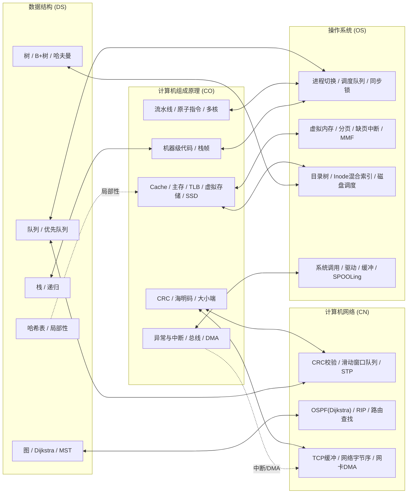

# 考研 408（计算机学科专业基础）知识点索引目录与大纲

> **文档定位**：面向个人学习与知识库建设的 **408 全四科知识点索引骨架（Index / Outline Only）**。本文仅收录章节结构、核心考点清单、考频与难度标注、跨科关联图谱及教材目录映射，**不展开具体概念教程**，便于后续在复习过程中按目录逐项填充笔记。
>
> **基准版本**：教育部教育考试院《全国硕士研究生招生考试计算机学科专业基础（408）考试大纲》（2022 年大改后定型，2023—2026 年保持高度稳定，结合 2025 细微增补）。

---

## 一、试卷结构与宏观考情总览

### 1.1 基本考试参数

| 项目 | 说明 |
| :--- | :--- |
| **科目代码与名称** | 408 计算机学科专业基础（全国统考，教育部教育考试院命题） |
| **满分与时长** | 满分 **150 分**，考试时间 **180 分钟**（闭卷、笔试） |
| **题型结构** | **单项选择题** 40 题 × 2 分 = 80 分；**综合应用题** 7 题 = 70 分 |

### 1.2 四科分值、题号分配与近年趋势

| 科目 | 总分占比 | 选择题题号与分值 | 综合应用题题号与分值 | 近年考情与命题特征 |
| :--- | :---: | :---: | :---: | :--- |
| **数据结构 (DS)** | **45 分** (30%) | 1–11 题（22 分） | 41–42 题（23 分） | 必考 1 道 C/C++ 算法设计大题（13–15 分）+ 1 道综合应用题（树/图/查找/排序）；2022 后新增红黑树、外部排序细节。 |
| **计算机组成原理 (CO)** | **45 分** (30%) | 12–22 题（22 分） | 43–44 题（23 分） | 概念抽象、计算密集；近年强推**机器级代码与 C 语言映射**、Cache/虚拟内存综合计算、指令流水线与 CPU 数据通路。 |
| **操作系统 (OS)** | **35 分** (23%) | 23–32 题（20 分） | 45–46 题（15 分） | 综合题高频锁定 **PV 同步互斥**、**虚拟内存/页式地址转换**、**文件系统/磁盘管理**；常与计组硬件机制联动命题。 |
| **计算机网络 (CN)** | **25 分** (17%) | 33–40 题（16 分） | 47 题（9 分） | 知识点碎但规律性强；第 47 题固定考查**网络层（子网/CIDR/路由协议/ARP）**或**传输层（TCP 可靠传输/流量与拥塞控制）**。 |

> **近年大纲演进速览（2022–2026）**：
> - **2022 年（历史最大修订）**：全面向现代计算机系统靠拢——新增**红黑树**、**固态硬盘（SSD）**、**程序的机器级代码表示**、**多核/多处理器基本概念**、**虚拟机**、**锁与条件变量**、**内存映射文件**、**虚拟文件系统（VFS）与挂载**、**无线局域网（IEEE 802.11）/VLAN**等。
> - **2023–2026 年（稳中微调）**：主干框架保持稳定；2025 年 OS 进一步细化进程间通信中的**信号（Signal）**与**多处理机调度（SMP）**考点。

---

## 二、四科完整知识点索引大纲

> **图例说明**：
> - 考频/权重：`★★★` 核心高频（大题/多选常客）｜`★★` 中频常考（选择/综合小问）｜`★` 基础了解（偶发选择）
> - 章节编号默认采用 **408 考纲 + 王道考研目录体系**（与真题对应最直接），每章末尾标注经典教材对应章节。

---

### 模块一：数据结构（Data Structures，约 45 分）

#### 第 1 章 绪论 `★`
> 教材映射：严蔚敏《数据结构》第 1 章
- **1.1 数据结构的基本概念**
  - 数据、数据元素、数据项、数据对象、数据结构、ADT（抽象数据类型）
  - 逻辑结构（集合、线性、树形、图状）与物理/存储结构（顺序、链式、索引、散列）
- **1.2 算法和算法评价**
  - 算法的 5 个基本特性（有穷性、确定性、可行性、输入、输出）
  - 时间复杂度（最好/最坏/平均，$O$ 渐进表示、递推与循环分析）`★★★`
  - 空间复杂度与原地工作（$O(1)$）

#### 第 2 章 线性表 `★★★`
> 教材映射：严蔚敏 第 2 章 ｜ 高频题型：算法设计大题（链表/双指针/原地逆置/归并）
- **2.1 线性表的定义和基本操作**
- **2.2 线性表的顺序表示（顺序表）**
  - 静态分配与动态分配、随机存取特性
  - 插入、删除、按值/按位查找的时间复杂度与平均移动次数
- **2.3 线性表的链式表示（链表）**
  - 单链表（头结点作用、头插法/尾插法、插入/删除/逆置/合并）`★★★`
  - 双链表、循环单/双链表、静态链表
  - 顺序表与链表的优缺点对比及适用场景

#### 第 3 章 栈、队列和数组 `★★`
> 教材映射：严蔚敏 第 3 章、第 5 章（不含广义表）
- **3.1 栈（Stack）**
  - 顺序栈、共享栈、链栈的基本操作
  - 出栈序列合法性与卡特兰数（Catalan Number）`★★`
- **3.2 队列（Queue）**
  - 顺序队列、循环队列（判空/判满的三种方式、元素个数公式）`★★`
  - 链式队列、双端队列（输入受限/输出受限）
- **3.3 栈和队列的应用**
  - 括号匹配、表达式求值（中缀/前缀/后缀转换与求值）`★★★`
  - 递归与函数调用栈、层次遍历与缓冲区应用
- **3.4 数组和特殊矩阵的压缩存储**
  - 多维数组的行优先与列优先地址计算 `★★`
  - 对称矩阵、三角矩阵、三对角矩阵的下标映射公式 `★★`
  - 稀疏矩阵存储（三元组表、十字链表）

#### 第 4 章 串 `★`
> 教材映射：严蔚敏 第 4 章 ｜ 考纲归入“查找-字符串模式匹配”
- **4.1 串的定义和存储结构**（定长顺序、堆分配、块链）
- **4.2 串的模式匹配**
  - 朴素模式匹配算法（暴力匹配）
  - KMP 算法原理、`next` 数组手算与 `nextval` 优化 `★★`

#### 第 5 章 树与二叉树 `★★★`
> 教材映射：严蔚敏 第 6 章 ｜ 高频题型：选择必考性质计算，大题常考二叉树递归遍历/WPL/并查集
- **5.1 树的基本概念与性质**（度、结点数与边数关系、高度、森林）
- **5.2 二叉树的概念与存储**
  - 满二叉树、完全二叉树、二叉排序树、平衡二叉树、正则二叉树
  - 二叉树核心性质（度为 0 与度为 2 结点关系、完全二叉树编号与高度）`★★★`
  - 顺序存储与链式存储（二叉链表、空链域个数）
- **5.3 二叉树的遍历与线索二叉树**
  - 先序、中序、后序（递归与非递归）、层次遍历 `★★★`
  - 由遍历序列唯一构造二叉树（中序+先/后/层序）`★★★`
  - 线索二叉树（先/中/后序线索化、找前驱与后继）`★★`
- **5.4 树与森林**
  - 树的存储结构（双亲表示法、孩子表示法、孩子兄弟表示法）
  - 树、森林与二叉树的相互转换 `★★`
  - 树和森林的遍历与对应二叉树遍历的映射关系
- **5.5 树与二叉树的应用**
  - 哈夫曼（Huffman）树与哈夫曼编码（带权路径长度 WPL、前缀编码、$k$ 叉哈夫曼树）`★★★`
  - 并查集（Union-Find：双亲数组表示、按秩合并与路径压缩优化）`★★`

#### 第 6 章 图 `★★★`
> 教材映射：严蔚敏 第 7 章 ｜ 高频题型：大题常考图遍历/最短路径/拓扑/存储操作
- **6.1 图的基本概念**（有向/无向图、完全图、连通/强连通分量、生成树、度与边数）
- **6.2 图的存储及基本操作**
  - 邻接矩阵、邻接表（空间复杂度、操作耗时对比）`★★★`
  - 十字链表（有向图）、邻接多重表（无向图）`★`
- **6.3 图的遍历**
  - 广度优先搜索（BFS）、深度优先搜索（DFS）及其生成树/森林 `★★★`
  - 遍历算法的时间/空间复杂度与连通性判定
- **6.4 图的基本应用**
  - 最小生成树（MST）：Prim 算法、Kruskal 算法及其性质与复杂度 `★★★`
  - 最短路径：BFS（无权图）、Dijkstra 算法（单源非负权）、Floyd 算法（全源）`★★★`
  - 有向无环图（DAG）描述表达式
  - 拓扑排序（AOV 网、唯一性判定、逆拓扑排序）`★★`
  - 关键路径（AOE 网：事件/活动的最早最迟发生时间、关键活动与工期压缩）`★★`

#### 第 7 章 查找 `★★★`
> 教材映射：严蔚敏 第 9 章（新版第 7 章）｜ 2022 新增红黑树为重要考点
- **7.1 查找的基本概念**（静态/动态查找表、平均查找长度 ASL 成功与失败）
- **7.2 顺序查找、折半查找与分块查找**
  - 一般/有序顺序查找、折半查找判定树构造与性能分析 `★★`
  - 分块查找（索引顺序查找）与理想块长 $\sqrt{n}$
- **7.3 树型查找**
  - 二叉排序树（BST）的查找、插入、删除 `★★`
  - 平衡二叉树（AVL 树）：平衡因子、LL/RR/LR/RL 旋转、最少结点递推 $n_h$ `★★★`
  - **红黑树（Red-Black Tree）**：5 条性质、黑高与树高界限、插入/删除调整思想 `★★`
  - **B 树与 B+ 树**：阶数与关键字数范围、高度上下界、插入（分裂）与删除（借位/合并）、B 树与 B+ 树差异 `★★★`
- **7.4 散列表（Hash Table）**
  - 常用散列函数（除留余数法、直接定址法等）
  - 冲突处理：开放定址法（线性/平方/双散列探测）、拉链法 `★★★`
  - 装填因子 $\alpha$、聚集现象、查找成功/失败的 ASL 计算 `★★★`

#### 第 8 章 排序 `★★★`
> 教材映射：严蔚敏 第 10 章（新版第 8 章）｜ 选择题必考复杂度/稳定性/趟数特征，大题常考快排/堆排/归并/外排
- **8.1 排序的基本概念**（内部/外部排序、稳定性定义）
- **8.2 插入排序**：直接插入排序、折半插入排序、希尔排序（增量序列与不稳定性）
- **8.3 交换排序**：冒泡排序、快速排序（Partition 划分、递归栈深、枢轴选择）`★★★`
- **8.4 选择排序**：简单选择排序、堆排序（大/小根堆构建、筛选、插入与删除）`★★★`
- **8.5 归并排序与基数排序**
  - 二路归并排序（分治过程、比较次数、空间开销）`★★`
  - 基数排序（MSD/LSD、分配与收集趟数、不基于比较）`★★`
- **8.6 各种内部排序算法的综合比较与应用**（时间/空间复杂度、稳定性、初始有序敏感度、每趟确定最终位置元素个数）`★★★`
- **8.7 外部排序**
  - 外部排序基本过程（生成初始归并段 + 多路归并）
  - 败者树（Loser Tree）优化多路归并 `★★`
  - 置换-选择排序（生成不等长初始归并段）`★★`
  - 最佳归并树（$k$ 叉哈夫曼树与虚段补充公式）`★★`

---

### 模块二：计算机组成原理（Computer Organization，约 45 分）

#### 第 1 章 计算机系统概述 `★`
> 教材映射：唐朔飞 第 1–2 章 / 袁春风 第 1 章
- **1.1 计算机发展历程与系统层次结构**
  - 冯·诺依曼结构特点（存储程序、五大部件、以运算器/存储器为中心）
  - 计算机软件分类、高级语言到机器语言的翻译过程（预处理→编译→汇编→链接）
  - 计算机系统多级层次结构、软硬件逻辑等价性
- **1.2 计算机性能指标**
  - 机器字长、数据通路带宽、主存容量、运算速度
  - 时钟周期、主频、CPI、IPC、CPU 执行时间、MIPS、MFLOPS、吞吐量与响应时间 `★★★`
  - 基准程序与阿姆达尔定律（Amdahl's Law）概念

#### 第 2 章 数据的表示和运算 `★★★`
> 教材映射：唐朔飞 第 6 章 / 袁春风 第 2–3 章 ｜ 必考大题与多道选择，重在 IEEE 754 与补码/类型转换
- **2.1 数制与编码**
  - 进位计数制转换、真值与机器数、BCD 码（8421/余3/2421）
  - 字符与字符串（ASCII、汉字编码）、**大端/小端模式**、**边界对齐** `★★`
  - 校验码：奇偶校验码、海明码（纠错/检错位数与校验位位置）、CRC 循环冗余校验码 `★★`
- **2.2 定点数的表示和运算**
  - 无符号数与有符号数（原码、反码、补码、移码及表示范围）
  - 算术/逻辑/循环移位、C 语言整数类型转换与截断/符号扩展 `★★★`
  - 补码加减运算、**溢出判别**（单符号位、双符号位变形补码、进位异或）`★★★`
  - 标志位生成（OF、SF、ZF、CF）及其在无符号/有符号比较中的含义 `★★★`
  - 原码一位乘、补码一位乘（Booth 算法）、原码恢复/加减交替除法、阵列乘除法器概念
- **2.3 浮点数的表示和运算**
  - **IEEE 754 标准**（单精度 float / 双精度 double 格式、阶码偏移、规格化/非规格化数、$\pm 0$、$\pm \infty$、NaN、机器零与表示范围）`★★★`
  - 浮点数加减运算（对阶、尾数加减、规格化、舍入、溢出判断）`★★`
  - C 语言 `int`/`float`/`double` 转换时的精度损失与范围问题 `★★★`
- **2.4 算术逻辑单元（ALU）**
  - 一位全加器、串行进位加法器、并行先行进位（CLA）加法器原理
  - ALU 基本结构与运算器组织

#### 第 3 章 存储系统 `★★★`
> 教材映射：唐朔飞 第 4 章 / 袁春风 第 7 章 ｜ 408 最高频大题模块之一，与 OS 内存管理深度交叉
- **3.1 存储器概述**
  - 存储器分类、性能指标、三级层次结构（Cache–主存–辅存）与局部性原理（时间/空间）
- **3.2 主存储器**
  - SRAM 与 DRAM 工作原理对比、DRAM 刷新方式（集中/分散/异步）与地址复用技术 `★★`
  - ROM 分类（MROM/PROM/EPROM/EEPROM/Flash）
  - 主存与 CPU 连接：字扩展、位扩展、字位同时扩展、片选译码 `★★`
  - 双端口 RAM、多模块存储器（单体多字、**低位交叉多体并行存储器**带宽与流水访问计算）`★★`
- **3.3 外部存储器**
  - 磁盘存储器（盘面/磁道/扇区、寻道/旋转/传输时间、磁盘阵列 RAID 0–5 概念）
  - **固态硬盘（SSD）**：闪存芯片原理、读写以页为单位、擦除以块为单位、磨损均衡（动态/静态）`★★`
- **3.4 高速缓冲存储器（Cache）**
  - Cache 工作原理、命中率与平均访问时间计算
  - **地址映射方式**：直接映射、全相联映射、组相联映射（主存地址划分：Tag/Index/Offset）`★★★`
  - Cache 总容量计算（数据区 + Tag + 有效位 + 脏位 + 替换算法位）`★★★`
  - 替换算法（随机、FIFO、LRU、LFU）与写策略（全写法/写回法、写分配/非写分配）`★★★`
  - 多级 Cache、指令 Cache 与数据 Cache 分离
- **3.5 虚拟存储器**
  - 虚拟地址到物理地址的硬件转换流程（结合 TLB 快表、页表、Cache 完整访存路径）`★★★`
  - 页式、段式、段页式虚拟存储器对比

#### 第 4 章 指令系统 `★★★`
> 教材映射：唐朔飞 第 7 章 / 袁春风 第 4 章 ｜ 2022 后新增“机器级代码”已成必考大题
- **4.1 指令格式**
  - 指令基本结构、零/一/二/三地址指令、定长操作码与**扩展操作码**设计 `★★`
  - 定长指令字与变长指令字
- **4.2 指令的寻址方式**
  - 指令寻址（顺序/跳跃）
  - 数据寻址：隐含、立即、直接、间接、寄存器、寄存器间接、相对（PC+偏移）、基址、变址、堆栈寻址 `★★★`
- **4.3 程序的机器级代码表示** `★★★`
  - x86 常用寄存器（EAX/EBX/ECX/EDX/ESI/EDI/EBP/ESP/EIP）与标志寄存器
  - 常用汇编指令（AT&T / Intel 风格识别：`mov`/`lea`/`push`/`pop`/`add`/`sub`/`cmp`/`test`/`jmp`/`jcc`/`call`/`ret`）
  - 选择语句（`if-else`、`switch` 跳转表）、循环语句（`for`/`while`）的机器级表示
  - **过程调用（函数调用）的机器级表示**：栈帧（Stack Frame）结构、参数传递、返回地址、调用者/被调用者保存寄存器
- **4.4 CISC 和 RISC 的基本概念与对比** `★★`

#### 第 5 章 中央处理器（CPU）`★★★`
> 教材映射：唐朔飞 第 8–10 章 / 袁春风 第 5–6、9 章 ｜ 大题高频：流水线冒险、数据通路、控制器
- **5.1 CPU 的功能和基本结构**
  - 运算器与控制器组成、用户可见寄存器与不可见寄存器（MAR/MDR/IR/PC/PSW）
- **5.2 指令执行过程**
  - 指令周期、机器周期、时钟周期；取指、间址、执行、中断周期的微操作数据流
- **5.3 数据通路的功能和基本结构**
  - 单总线、多总线、专用数据通路结构；控制信号与微操作序列分析 `★★★`
- **5.4 控制器的功能和工作原理**
  - 硬布线（组合逻辑）控制器设计思想与特点
  - 微程序控制器（微指令、微操作、控制存储器 CM、水平型与垂直型微指令、字段直接/间接编码、下地址生成）`★★`
- **5.5 异常和中断机制**
  - 异常（内部：故障/陷阱/终止）与中断（外部：可屏蔽/不可屏蔽）分类与区别 `★★★`
  - 异常与中断的硬件响应过程（关中断、保存断点与 PC、识别中断源/向量中断、转入服务程序）
- **5.6 指令流水线** `★★★`
  - 流水线基本概念、五段流水线（IF/ID/EX/MEM/WB）、吞吐率/加速比/效率计算
  - **流水线冒险（Hazard）与解决**：结构冒险、数据冒险（RAW/WAR/WAW、**旁路/转发 Forwarding**、Load-Use 阻塞）、控制冒险（分支预测、延迟槽）
  - 高级流水线：超标量、动态流水线（乱序执行概念）、超长指令字（VLIW）
- **5.7 多处理器基本概念** `★`
  - SISD / SIMD / MIMD 分类、硬件多线程（细粒度/粗粒度/同时多线程 SMT）
  - 多核处理器（Multi-core）、对称多处理器（SMP）、共享内存多处理器与 Cache 一致性概念

#### 第 6 章 总线 `★`
> 教材映射：唐朔飞 第 3 章 / 袁春风 第 8 章
- **6.1 总线概述**：概念、分类（片内/系统/通信总线）、系统总线结构（单/双/三总线）、性能指标（宽度/频率/带宽计算）`★★`
- **6.2 总线的操作和定时**：总线事务（请求/仲裁/寻址/传输/释放）、同步定时与异步定时（全互锁/半互锁/不互锁）
- **6.3 总线仲裁与标准**（了解：集中式链式/计数器/独立请求、分布式；PCI/PCIe/USB 等常见标准）

#### 第 7 章 输入/输出（I/O）系统 `★★`
> 教材映射：唐朔飞 第 5 章 / 袁春风 第 8 章 ｜ 与 OS I/O 管理深度联动
- **7.1 I/O 系统基本概念与 I/O 接口**
  - I/O 接口功能与内部结构（数据/状态/控制寄存器）
  - I/O 端口编址方式（统一编址 vs 独立编址）
- **7.2 I/O 控制方式** `★★★`
  - 程序查询方式（CPU 轮询开销计算）
  - 程序中断方式（中断请求、判优、响应条件、向量中断、多重中断与屏蔽字、中断开销计算）
  - **DMA 方式**：DMA 控制器组成、预处理/数据传送/后处理三阶段、周期窃取、DMA 与中断方式的区别与开销计算

---

### 模块三：操作系统（Operating Systems，约 35 分）

#### 第 1 章 操作系统概述 `★`
> 教材映射：汤小丹 第 1 章
- **1.1 操作系统的概念、特征与功能**
  - 四大特征：**并发**（与并行区分）、**共享**（互斥共享/同时访问）、虚拟、异步
  - 提供的接口（命令接口、程序接口/系统调用、GUI）
- **1.2 操作系统的发展与分类**（手工、单道/多道批处理、分时、实时、网络/分布式/嵌入式）
- **1.3 操作系统的运行环境** `★★★`
  - CPU 运行模式（内核态/核心态 vs 用户态）、特权指令与非特权指令
  - 中断与异常在 OS 中的处理流程、**系统调用**（执行过程、陷入指令 Trap）
- **1.4 操作系统体系结构与引导**
  - 宏内核（大内核）vs 微内核、分层/模块化结构
  - 操作系统引导（Booting：ROM BIOS → MBR → 活动分区 PBR → OS 内核）`★★`
  - **虚拟机（Virtual Machine）**：第一类与第二类 VMM/Hypervisor 架构对比 `★`

#### 第 2 章 进程与线程 `★★★`
> 教材映射：汤小丹 第 2–3 章 ｜ OS 分值最高章节，PV 同步大题几乎年年必考
- **2.1 进程与线程**
  - 进程概念、组成（PCB/程序段/数据段）、进程映像（代码/数据/堆/栈/内核区）
  - 进程状态转换（创建/就绪/运行/阻塞/终止、挂起状态）`★★`
  - 进程控制（原语：创建/终止/阻塞/唤醒/切换）
  - 进程间通信（IPC）：共享内存、消息传递（直接/间接）、管道（匿名/命名）、**信号（Signal）** `★★`
  - 线程概念、进程与线程对比、线程实现方式（用户级 ULT / 内核级 KLT / 组合）与多线程模型 `★★`
- **2.2 处理机调度** `★★★`
  - 调度层次（高级/中级/低级）、调度时机与不能进行调度的情况、闲逛进程
  - 调度性能指标（CPU 利用率、吞吐量、周转时间/带权周转时间、等待时间、响应时间）
  - 经典调度算法：FCFS、SJF/SRTN、优先级调度、高响应比优先（HRRN）、时间片轮转（RR）、多级队列、多级反馈队列（MLFQ）`★★★`
  - **多处理机调度（SMP）**：公共/私有就绪队列、负载均衡、处理机亲和性（2025 细化）`★`
- **2.3 同步与互斥** `★★★`
  - 临界资源、临界区、互斥访问四原则（空闲让进、忙则等待、有限等待、让权等待）
  - 软件实现（单标志/双标志/Peterson 算法）与硬件实现（中断屏蔽、`TestAndSet`/`Swap` 原子指令）
  - **互斥锁（Mutex）、信号量机制（整型/记录型信号量与 PV 操作）、管程（Monitor）与条件变量**
  - 经典同步问题及变种：生产者–消费者、读者–写者、哲学家进餐、吸烟者问题、前驱图同步 `★★★`
- **2.4 死锁** `★★`
  - 死锁概念与 4 个必要条件（互斥、不剥夺、请求并保持、循环等待）
  - 死锁预防（破坏四条件之一）
  - **死锁避免**：系统安全状态、**银行家算法**（安全序列判定）`★★★`
  - 死锁检测（资源分配图化简）与死锁解除

#### 第 3 章 内存管理 `★★★`
> 教材映射：汤小丹 第 4–5 章 ｜ 必考大题模块，与计组存储系统无缝衔接
- **3.1 内存管理概念**
  - 编译→链接（静态/装入时动态/运行时动态）→装入（绝对/静态重定位/动态重定位）
  - 逻辑地址与物理地址空间、内存保护（上下限/重定位与界地址寄存器）、覆盖与交换
- **3.2 连续分配管理方式**
  - 单一连续分配、固定分区分配（内部碎片）
  - 动态分区分配（外部碎片、**首次/最佳/最坏/邻近适应算法**、紧凑）`★★`
- **3.3 非连续分配管理方式** `★★★`
  - **基本分页存储管理**：页表、地址变换机构、快表（TLB）访问时间计算、**多级页表**（二级/多级页表大小与地址结构）
  - 基本分段存储管理：段表、地址变换、信息共享与保护
  - 段页式存储管理
- **3.4 虚拟内存管理** `★★★`
  - 局部性原理、虚拟存储器特征与容量限制
  - **请求分页管理**：页表项扩展（有效位/访问位/修改位/外存地址）、缺页中断处理过程
  - **页面置换算法**：最佳（OPT）、先进先出（FIFO，Belady 异常）、最近最久未使用（LRU）、时钟（CLOCK / 简单与改进型）`★★★`
  - 页面分配策略（固定/可变分配 × 局部/全局置换）、调页策略（预调页/请求调页）
  - **抖动（颠簸）现象**与**工作集（Working Set）**模型
  - **内存映射文件（Memory-Mapped Files）**：基本原理、与标准文件 I/O 对比、共享内存应用 `★★`

#### 第 4 章 文件管理 `★★★`
> 教材映射：汤小丹 第 7–8 章 ｜ 近年大题常考索引结点/混合索引最大文件计算与磁盘调度
- **4.1 文件系统基础**
  - 文件概念、属性、逻辑结构（无结构流式/有结构记录式：顺序/索引/索引顺序）
  - 目录结构（单级/两级/树形/无环图）、文件控制块（FCB）与**索引结点（Inode）**分离加速查找 `★★★`
  - 文件共享（硬链接基于索引结点 vs 软链接/符号链接）与文件保护（访问控制表/口令/权限位）
- **4.2 文件系统实现** `★★★`
  - 文件系统层次结构、目录实现（线性列表/哈希表）
  - **文件物理结构（外存分配方式）**：连续分配、链接分配（隐式/显式 FAT）、**索引分配**（单级/多级/UNIX 混合索引最大文件长度与磁盘 I/O 次数计算）`★★★`
  - 文件存储空间管理（空闲表、空闲链表、**位示图**、成组链接法）`★★`
  - 打开文件表（系统打开文件表与进程打开文件表、文件描述符）`★★`
  - **虚拟文件系统（VFS）**：超级块/索引结点/目录项/文件对象概念及**文件系统挂载（Mount）** `★★`
- **4.3 磁盘与固态硬盘管理**
  - 磁盘物理结构、格式化（低级物理格式化与逻辑格式化）、磁盘读写时间组成
  - **磁盘调度算法**：FCFS、SSTF、SCAN（电梯算法）、LOOK、C-SCAN、C-LOOK `★★`
  - 磁盘地址交替编号与错位命名减少延迟时间、坏块管理

#### 第 5 章 输入/输出（I/O）管理 `★★`
> 教材映射：汤小丹 第 6 章
- **5.1 I/O 管理概述**
  - I/O 设备分类（块设备/字符设备、独占/共享/虚拟设备）
  - I/O 控制方式演进（程序直接控制→中断→DMA→通道）
  - **I/O 软件层次结构**（用户层→设备独立性软件→设备驱动程序→中断处理程序→硬件）`★★`
- **5.2 I/O 核心子系统**
  - I/O 调度、高速缓存与**缓冲区管理**（单缓冲、双缓冲、循环缓冲、缓冲池，单/双缓冲耗时计算）`★★`
  - 设备分配与回收（DCT/COCT/CHCT/SDT、逻辑设备名到物理设备名映射、安全/不安全分配）
  - **假脱机技术（SPOOLing）**：输入井/输出井组成、将独占设备改造为共享虚拟设备的原理 `★★`

---

### 模块四：计算机网络（Computer Networks，约 25 分）

#### 第 1 章 计算机网络体系结构 `★`
> 教材映射：谢希仁《计算机网络》第 1 章
- **1.1 计算机网络概述**：概念、组成（边缘/核心部分）、功能、分类（LAN/MAN/WAN、拓扑结构）
- **1.2 性能指标** `★★`
  - 速率、带宽、吞吐量、**时延**（发送/传播/处理/排队时延）、时延带宽积、往返时间（RTT）、信道利用率
- **1.3 体系结构与参考模型**
  - 协议三要素（语法/语义/同步）、接口与服务（SAP/PDU/SDU/PCI）
  - **OSI 七层参考模型** vs **TCP/IP 四层模型** vs **五层教学模型**各层功能与典型协议映射 `★★`

#### 第 2 章 物理层 `★★`
> 教材映射：谢希仁 第 2 章
- **2.1 通信基础**
  - 信道、码元、波特率与比特率
  - **奈奎斯特定理**（无噪信道极限码元速率）与 **香农定理**（有噪信道极限数据传输率）`★★★`
  - 编码与调制：NRZ、**曼彻斯特编码、差分曼彻斯特编码**、ASK/FSK/PSK/QAM `★★`
  - 交换方式：电路交换、报文交换、**分组交换**（数据报 vs 虚电路）的时延对比 `★★`
- **2.2 传输介质与物理层设备**
  - 双绞线、同轴电缆、光纤、无线介质特点
  - 中继器（放大整形、5-4-3 规则）、集线器（Hub，广播、同属一个冲突域）

#### 第 3 章 数据链路层 `★★★`
> 教材映射：谢希仁 第 3 章、第 9 章（WLAN）｜ 必考协议计算（CSMA/CD、滑动窗口信道利用率、交换机转发）
- **3.1 数据链路层功能**
  - 组帧（字符计数、字节填充、零比特填充、违规编码）
  - 差错控制：检错编码（CRC 循环冗余校验）、纠错编码（海明码）`★★`
  - **流量控制与可靠传输机制**：停止–等待（SW）、后退 $N$ 帧（GBN）、选择重传（SR）的窗口大小限制与**信道利用率计算** `★★★`
- **3.2 介质访问控制（MAC）**
  - 信道划分：FDM、TDM、STDM、WDM、**CDMA（码分多址正交码片内积计算）** `★★`
  - 随机访问：ALOHA、CSMA、**CSMA/CD**（争用期 $2\tau$、最小帧长公式、二进制指数退避）、**CSMA/CA**（无线隐蔽站、RTS/CTS、IFS、ACK）`★★★`
  - 轮询访问：令牌传递协议
- **3.3 局域网与广域网**
  - **以太网（IEEE 802.3）**：MAC 地址、以太网 V2 帧格式、高速以太网 `★★`
  - **无线局域网（IEEE 802.11）**：基本组成（BSS/AP/SSID）、802.11 帧的四个地址字段含义 `★★`
  - **虚拟局域网（VLAN）**：隔离广播域、802.1Q 帧标签概念 `★`
  - 广域网协议：PPP 协议（面向字节/零比特填充、无编号不可靠）、HDLC 协议
- **3.4 数据链路层设备**
  - 网桥与**以太网交换机**：自学习算法、转发表构建、直通与存储转发、隔离冲突域但同属广播域 `★★★`

#### 第 4 章 网络层 `★★★`
> 教材映射：谢希仁 第 4 章 ｜ 第 47 题最核心命题区之一
- **4.1 网络层功能**
  - 异构网络互联、路由与转发、拥塞控制、**SDN（软件定义网络）**控制平面与数据平面分离概念 `★`
- **4.2 路由算法**
  - 静态路由 vs 动态路由
  - 距离–向量路由算法（Bellman-Ford、慢收敛/坏消息传得慢）、链路状态路由算法（Dijkstra）、层次路由 `★★`
- **4.3 IPv4 协议** `★★★`
  - IPv4 分组首部格式与**IP 分片计算**（总长度、标识、MF/DF、片偏移 8B 单位）`★★★`
  - IPv4 分类地址、特殊地址、私有地址与 **NAT（网络地址转换）**
  - **子网划分、子网掩码、无分类编址 CIDR、路由聚合与最长前缀匹配** `★★★`
  - **ARP**（IP→MAC 解析流程与跨网段转发中的 MAC/IP 变化）、**DHCP**（动态获取 IP 四报文）、**ICMP**（差错报告与询问报文、`ping`/`traceroute` 原理）`★★★`
- **4.4 IPv6**：主要特点、基本首部、地址表示法与过渡技术（双协议栈/隧道）`★`
- **4.5 路由协议** `★★★`
  - 自治系统（AS）、内部网关协议 **RIP**（UDP、跳数上限 15）、**OSPF**（IP、链路状态、洪泛、划分区域）
  - 外部网关协议 **BGP**（TCP、路径向量、策略路由、eBGP/iBGP）
- **4.6 IP 组播与移动 IP**
  - 组播地址（D 类）、组播 MAC 映射、IGMP 协议；移动 IP 基本通信过程 `★`
- **4.7 网络层设备**
  - 路由器的组成与工作原理、隔离冲突域与广播域、分组转发算法 `★★`

#### 第 5 章 传输层 `★★★`
> 教材映射：谢希仁 第 5 章 ｜ 第 47 题另一核心命题区
- **5.1 传输层提供的服务**
  - 进程间端到端通信、端口号（熟知/登记/短暂）、复用与分用
- **5.2 UDP 协议**
  - UDP 特点、首部格式（8 字节）、伪首部校验和计算 `★★`
- **5.3 TCP 协议** `★★★`
  - TCP 特点与首部格式（序号、确认号、SYN/ACK/FIN/RST、窗口 rwnd、MSS）
  - **TCP 连接管理**：三次握手建立连接、四次挥手释放连接（TIME_WAIT $2\text{MSL}$ 原因、序号/确认号演变）`★★★`
  - **TCP 可靠传输**：字节流编号、累积确认、超时重传（加权平均 RTT）、快速重传
  - **TCP 流量控制**：基于接收窗口 `rwnd` 的滑动窗口机制
  - **TCP 拥塞控制**：发送窗口 $\min(\text{rwnd}, \text{cwnd})$、**慢开始、拥塞避免、快重传、快恢复**（Reno/Tahoe 窗口变化轮次计算）`★★★`

#### 第 6 章 应用层 `★★`
> 教材映射：谢希仁 第 6 章
- **6.1 网络应用模型**：C/S 模型 vs P2P 模型
- **6.2 域名系统（DNS）**：层次域名空间、根/顶级/权限/本地域名服务器、**递归查询与迭代查询**（UDP 53）`★★`
- **6.3 文件传输协议（FTP）**：控制连接（TCP 21）与数据连接（TCP 20，主动/被动模式）`★★`
- **6.4 电子邮件**：体系结构、**SMTP**（TCP 25，推送）、**POP3**（TCP 110）/ **IMAP**（TCP 143）、MIME `★★`
- **6.5 万维网（WWW）与 HTTP 协议** `★★★`
  - URL、HTML、HTTP 报文结构与常见状态码
  - **非持久连接（HTTP/1.0）vs 持久连接（HTTP/1.1 非流水线/流水线）**耗时计算
  - Cookie 与无状态特性

---

## 三、四科交叉关联图谱（Cross-Subject Connections）

408 近年命题（尤其是 43–46 题）越来越倾向于打破单科边界，从**“程序 → 编译器/OS → 硬件/网络”**全栈视角出题。下表与关系图梳理了五大核心跨科脉络，建议在知识库中建立双向链接（Backlinks）。

### 3.1 跨科关联总览图

### 3.2 五大核心交叉专题对照表

| 交叉专题 | 数据结构 (DS) | 计算机组成原理 (CO) | 操作系统 (OS) | 计算机网络 (CN) | 典型综合考法 |
| :--- | :--- | :--- | :--- | :--- | :--- |
| **1. 存储层次与虚拟内存** | 数组/链表空间局部性；B/B+树按磁盘块组织减少 I/O | Cache 映射/命中率、TLB 快表、主存编址、虚拟地址硬件转换、SSD 闪存特性 | 分页/多级页表、缺页中断、页面置换（LRU/CLOCK）、工作集、内存映射文件 | 网卡/内核收发缓冲区（零拷贝背景） | 给定虚拟地址，连贯追踪 **TLB → 页表 → 缺页中断 → Cache → 主存** 全路径（43/44/45 题高频） |
| **2. 中断、异常、总线与 I/O** | 缓冲区队列结构 | 异常与中断响应流程、向量中断、系统总线仲裁、程序查询/中断/DMA 硬件机制 | 内核态/用户态切换、陷入指令与系统调用、中断处理程序、设备驱动、缓冲与 SPOOLing | 网卡收到帧后通过 DMA 写入内存并触发硬件中断 | 结合磁盘/网卡数据传送，计算中断方式 vs DMA 方式的 CPU 占用率与总耗时 |
| **3. 程序执行与并发底层** | 函数递归与运行栈；并发安全数据结构 | 指令流水线、**机器级代码与函数调用栈帧**、原子指令（TSL/Swap）、多核与 Cache 一致性 | 进程地址空间映像、上下文切换、硬件级互斥实现、信号量/互斥锁、SMP 多核调度 | 多线程/事件驱动网络服务器并发模型（背景） | 给出一段 C 代码与对应汇编，分析栈帧、数组越界、Cache 命中率与缺页次数 |
| **4. 算法与数据结构在系统中的落地** | 队列/优先队列、树与多叉树、图（Dijkstra/MST）、哈希表 | 硬件查表与相联存储器（CAM） | 就绪/阻塞队列、多级反馈队列、树形文件目录与多级索引、空闲空间位示图 | **OSPF（Dijkstra）**、**RIP（Bellman-Ford）**、以太网生成树、路由表最长前缀匹配、滑动窗口 | 直接在计网题中考 Dijkstra 迭代过程，或在 OS 题中考索引树最大文件容量 |
| **5. 编码、差错控制与字节序** | 位运算与压缩编码（哈夫曼） | 奇偶校验、海明码、**CRC 循环冗余校验**、**大端/小端字节序** | 文件系统与内存数据的字节对齐 | 数据链路层 **CRC 帧校验**、海明码纠错、**网络字节序（Big-Endian）** | CRC 生成多项式与余数手算在 CO 和 CN 两科通用 |

---

## 四、经典教材 vs 考试大纲/王道 目录体系对比与选型建议

### 4.1 四科权威教材与应试书结构对照

| 科目 | 经典教材（权威蓝本） | 经典教材目录特点 | 408 考纲 / 王道体系特点 | 关键差异点 |
| :--- | :--- | :--- | :--- | :--- |
| **数据结构** | 严蔚敏、吴伟民《数据结构（C语言版）》（清华大学出版社）；严蔚敏等第 2 版（人民邮电出版社） | 9–10 章，含“广义表”“动态存储管理”“文件”等本科拓展章；代码偏类 C 伪代码 | 8 章，严格按考纲精简，将“串”独立成章，将 BST/AVL/红黑树/B树归入“查找” | 严书无红黑树（旧版），且广义表/动态存储不考；王道代码更贴近标准 C/C++ 且补齐了并查集与红黑树。 |
| **计算机组成原理** | ① 唐朔飞《计算机组成原理（第3版）》（高教社） ② 袁春风《计算机组成与系统结构（第3版）》（清华社） | 唐书 10 章，先讲总线/存储/IO 再讲运算器/指令/CPU（偏传统硬件电路）； 袁书 9 章，先讲数据表示/运算/指令/CPU/流水线再讲存储/IO/多核（贴近 CSAPP 与现代体系结构） | 7 章：概述 → 数据表示与运算 → 存储系统 → 指令系统（含机器级代码）→ CPU（含流水线与多核）→ 总线 → I/O | **近年 408 命题风格明显偏向袁春风教材与 CSAPP**（如机器级代码、IEEE 754、流水线与虚拟存储联动）；唐书在传统总线与微程序细节上更详尽。 |
| **操作系统** | 汤小丹、汤子瀛等《计算机操作系统（第4版 / 慕课版）》（西电社 / 邮电社） | 12 章，将“进程描述/同步”与“调度/死锁”、“内存”与“虚拟内存”、“文件”与“磁盘”拆为独立章节，含多处理机/安全等拓展章 | 5 章：概述 → 进程与线程（含调度/同步/死锁）→ 内存管理（含虚拟内存）→ 文件管理（含磁盘）→ I/O 管理 | 王道将汤书的 8 章核心内容高度聚合为 5 大模块，并补充了 2022–2025 考纲新增的**内存映射文件、VFS、虚拟机、信号、SMP 调度**。 |
| **计算机网络** | 谢希仁《计算机网络（第8版 / 第9版）》（电子工业出版社） | 9 章，前 6 章按五层模型自底向上展开，后 3 章为“网络安全”“音视频服务”“无线与移动网络” | 6 章：体系结构 → 物理层 → 数据链路层（融入 WLAN/VLAN）→ 网络层 → 传输层 → 应用层 | 408 计网大纲几乎完全以谢书前 6 章 + 第 9 章 WLAN 为蓝本；谢书第 7–8 章（安全、多媒体）基本不在 408 统考范围内。 |

### 4.2 个人知识库/站点目录分类法（Taxonomy）选型建议

针对个人网站构建 408 知识索引，建议采用 **“408 考纲 / 王道章节树为主骨架 + 经典教材章节作溯源标签 + 跨科标签（Tags）作横向串联”** 的混合架构：

1. **主导航采用「408 考纲 / 王道」章节编号**（DS 8 章、CO 7 章、OS 5 章、CN 6 章，共 26 章）：
   - **理由**：颗粒度均衡、无超纲冗余章节，直接对齐真题题号与复习节奏，且已原生包含 2022–2025 全部新增考点（红黑树、机器级代码、SSD、VFS、MMF 等）。
2. **在每章文档头部保留「经典教材映射」元信息**：
   - 遇到底层机制模糊处（如计组机器级代码/流水线查**袁春风**，传统控制器查**唐朔飞**，OS 概念细节查**汤小丹**，网络协议细节查**谢希仁**），可一键定位原教材章节做权威核验。
3. **利用站点标签/双链建立「跨科专题视图」**：
   - 将本文第三节的五大跨科专题（如 `#虚拟内存`、`#中断与IO`、`#机器级代码`、`#校验码`）设为全局 Tag，复习到后期（冲刺与真题阶段）可按专题横向串联四本书。

---

## 五、参考来源（Sources）

1. **官方考试大纲**：教育部教育考试院（原教育部考试中心），《全国硕士研究生招生考试计算机学科专业基础（408）考试大纲》（2022 年修订版及 2024–2026 年历年大纲对比汇总，高等教育出版社）。
2. **数据结构经典教材**：严蔚敏、吴伟民，《数据结构（C语言版）》，清华大学出版社；严蔚敏、李冬梅、吴伟民，《数据结构（C语言版 第2版）》，人民邮电出版社。
3. **计算机组成原理经典教材**：
   - 唐朔飞，《计算机组成原理（第3版）》，高等教育出版社。
   - 袁春风、唐杰、杨若瑜、李俊等，《计算机组成与系统结构（第3版）》，清华大学出版社。
4. **操作系统经典教材**：汤小丹、王红玲、姜华、汤子瀛，《计算机操作系统（第4版 / 慕课版）》，西安电子科技大学出版社 / 人民邮电出版社。
5. **计算机网络经典教材**：谢希仁，《计算机网络（第8版 / 第9版）》，电子工业出版社。
6. **应试指导与历年真题分析**：王道论坛，《2025/2026 年计算机考研复习指导（数据结构 / 计算机组成原理 / 操作系统 / 计算机网络）》及历年 408 统考真题题型与分值分布统计。
