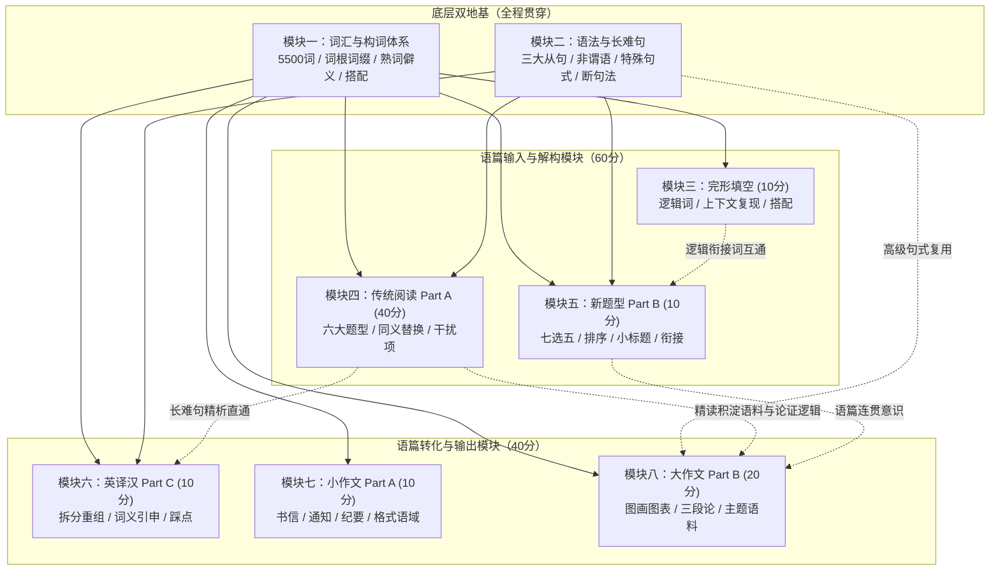

# 考研英语（一）（科目代码 201）知识点与能力模块索引大纲

> **文档定位**：面向个人学习与知识库建设的 **考研英语（一）全模块知识点与能力索引骨架（Index / Outline Only）**。不同于 408 或数学一按教材章节组织，英语（一）以**语言地基（词汇/语法）+ 题型能力模块（完形/阅读/新题型/翻译/写作）**构建索引。本文仅收录模块结构、核心考点与方法清单、分值权重、考频标注及个人网站**交互式学习组件（Interactive Widget）构想**，**不展开具体教程讲解**，便于后续按目录逐项沉淀真题笔记与语料。
>
> **基准版本**：教育部教育考试院《全国硕士研究生招生考试英语（一）考试大纲》（2023 年大纲表述规范后定型，2024—2026 年试卷结构与分值保持高度稳定；词汇表于 2025 版微调至 5549 词）。

---

## 一、试卷结构、评分标准与宏观考情总览

### 1.1 基本考试参数

| 项目 | 说明 |
| :--- | :--- |
| **科目代码与名称** | 201 英语（一）（全国统考，教育部教育考试院命题，主要面向学硕及部分专硕） |
| **满分与时长** | 满分 **100 分**，考试时间 **180 分钟**（14:00–17:00，闭卷笔试） |
| **总题量与构成** | 共 **52 题**（客观题 45 题共 60 分 + 主观题 7 题共 40 分） |
| **大纲词汇基准** | 约 **5500 词**（2025 版词表共 5549 词，仅删去 `coke` 一词）+ 词缀/缩写/地名附表；卷面允许少量超纲词且**不给中文注释** |

### 1.2 试卷题型、题号与分值分布

| 部分 | 节次 | 题型名称 | 题号与题量 | 分值与权重 | 篇章规模与大纲考查目标 |
| :--- | :--- | :--- | :---: | :---: | :--- |
| **Section I** | — | **英语知识运用**（完形填空） | 1–20 题（20 题 × 0.5 分） | **10 分** (10%) | 1 篇约 240–280 词短文；考查语境词汇辨析、固定搭配、语法结构与语篇衔接 |
| **Section II** | **Part A** | **传统阅读理解**（多项选择） | 21–40 题（20 题 × 2 分） | **40 分** (40%) | 4 篇文章共约 1600 词；考查主旨要义、具体信息、词义推断、推理判断、作者态度与论证结构 |
| | **Part B** | **阅读新题型**（选择搭配等） | 41–45 题（5 题 × 2 分） | **10 分** (10%) | 1 篇约 500–600 词；从**七选五、段落排序、小标题匹配** 3 种备选题型中任选 1 种，考查语段连贯性与篇章结构 |
| | **Part C** | **英译汉**（划线句翻译） | 46–50 题（5 句 × 2 分） | **10 分** (10%) | 1 篇约 400 词文章中划出 5 个长难句（合计约 150 词）；考查复杂语篇精准理解与规范汉语表达 |
| **Section III** | **Part A** | **应用文写作**（小作文） | 51 题（1 篇） | **10 分** (10%) | 约 100 词；涵盖**书信、通知、告示、纪要**（及传统备忘录、报告等），考查格式、语域与要点覆盖 |
| | **Part B** | **短文写作**（大作文） | 52 题（1 篇） | **20 分** (20%) | 160–200 词；根据**图画、图表或文字材料**写作，考查审题立意、逻辑论述与语言丰富度 |
| **合计** | — | — | **52 题** | **100 分** (100%) | **阅读类（Part A+B+C）占 60 分，写作类占 30 分，完形占 10 分** |

### 1.3 官方主观题评分标准速览

1. **英译汉（Part C，10 分）—— 意群踩点给分 + 特殊扣分**：
   - **标准**：准确、完整、通顺；每句拆分为 3–4 个核心意群（采分点），按点给分（通常 0.5 分/点）。
   - **大意扭曲**：明显扭曲原文核心语义者，该句得分**不超过 0.5 分**。
   - **多重译法**：同一句给出多个译法时，均正确才得分；若其一有误，**按错误译法计分**。
   - **中文错别字**：全篇累计，**满 3 个扣 0.5 分**（无 0.25 分档）。
2. **写作（Part A 10 分 + Part B 20 分）—— 整体印象五档评分**：

| 档次 | Part A 分段 | Part B 分段 | 核心判定维度（要点 / 语言 / 衔接 / 格式语域） |
| :--- | :---: | :---: | :--- |
| **第五档（优秀）** | 9–10 分 | 17–20 分 | 包含所有要点；语法结构与词汇丰富自然，几乎无错；衔接有效、层次清晰；格式与语域贴切 |
| **第四档（较好）** | 7–8 分 | 13–16 分 | 包含所有要点（可漏 1–2 个次重点）；语法词汇较丰富，尝试复杂结构时偶有小错；衔接适当 |
| **第三档（基本完成）** | 5–6 分 | 9–12 分 | 漏掉部分内容但含多数要点；语言基本满足任务，有一定错误但不影响整体理解；衔接较简单 |
| **第二档（欠佳）** | 3–4 分 | 5–8 分 | 漏掉重要要点或含无关内容；句式词汇单调、错误较多且影响理解；欠连贯 |
| **第一档（差）** | 1–2 分 | 1–4 分 | 严重遗漏要点或偏题；错误密集阻碍理解；无衔接与格式意识（白卷/完全无关给 0 分） |

> **写作附加扣分红线**：字数不足酌情扣分；**书写潦草影响交际者直接降一档**；应用文直接整句抄袭题干提示语将被扣分。

> **近年大纲演进速览（2023–2026）**：
> - **2023 年**：应用文（Part A）大纲表述正式统一并纳入**“纪要（Minutes）”**；大作文（Part B）明确兼容**“文字、图画、图表”**多元提示信息。
> - **2024–2026 年**：大纲主干零变动；真题层面大作文出现**“图画 + 图表”复合型**与纯图表趋势（如 2024 英语一图画结合公园数据、2025 图表类拓展），阅读与完形进一步强化**熟词僻义、语境推断与反模板化表达**。

---

## 二、八大能力与题型模块完整索引大纲

> **图例说明**：
> - 权重/考频：`★★★` 核心高频（提分命脉）｜`★★` 中频常考（稳分关键）｜`★` 低频/兜底（防翻车）
> - 交互组件标注：`🧩 Widget` 表示适合在个人知识库站点中内置的前端交互式学习组件构想。

---

### 模块一：词汇与构词体系（底层地基｜贯穿全卷 100 分）`★★★`

> **模块定位**：所有题型的共同前置依赖；考研英语一的核心痛点不是“背完 5500 词表”，而是**高频核心词的多义网络、词根词缀派生推断、熟词僻义与语境搭配**。

#### 1.1 大纲 5500 词分层索引 `★★★`
- **1.1.1 高频核心词（真题复现 ≥ 5 次，约 1500–2000 词）**
  - 抽象学术动词与名词（经济、科技、社会、法律、心理、生态六大真题主题域）
  - 态度与评价形容词/副词（直接服务阅读态度题与完形感情色彩）
- **1.1.2 中频认知词（真题复现 1–4 次，约 2000 词）**
  - 只需掌握核心中文义项与词性，用于阅读快速解码
- **1.1.3 低频与基础保底词（约 1500 词）**
  - 查漏补缺，重点排查**易混淆拼写**与**词性转换**
- **1.1.4 大纲附表与超纲词应对**
  - 常见缩写词（如 `e.g.`, `i.e.`, `etc.`, `Sq.` 等）、常用国家/地区与专有名词
  - 超纲词语境猜词线索（定义/同位语、举例、对比转折、因果、构词法）

#### 1.2 高频词根与词缀派生体系（大纲附录核心）`★★★`
- **1.2.1 方向、空间与否定前缀**
  - 否定/相反：`un-`, `in-/im-/il-/ir-`, `dis-`, `non-`, `anti-`, `counter-`, `de-`, `mis-`
  - 空间/时间/程度：`pre-/post-`, `sub-/super-`, `inter-/intra-`, `trans-`, `over-/under-`, `out-`, `ex-/en-`, `co-/con-`
- **1.2.2 词性决定后缀**
  - 名词后缀：`-tion/-sion`, `-ment`, `-ity/-ty`, `-ance/-ence`, `-ship`, `-hood`, `-ism/-ist`
  - 形容词后缀：`-al`, `-ive`, `-able/-ible`, `-ous`, `-ful/-less`, `-ic/-ical`, `-ary/-ory`
  - 动词后缀：`-ize/-ise`, `-ify`, `-ate`, `-en`
- **1.2.3 考研高频拉丁/希腊词根家族**
  - 如 `spect/vis`（看）、`duc/duct`（引导）、`fer`（带）、`press`（压）、`tract`（拉）、`pose/pon`（放）、`vert/vers`（转）、`ceed/cess`（走）、`sist/stat`（站立）、`tain/ten`（保持）等

#### 1.3 熟词僻义与一词多义 `★★★`
- **1.3.1 名词动词化与动词名词化**（如 `address`, `bridge`, `champion`, `harbor`, `weather`, `coin`, `court`）
- **1.3.2 高频抽象词的学术/法律/商业僻义**（如 `subject`, `account`, `observe`, `novel`, `discipline`, `school`, `instrument`, `sentence`, `party`, `bill`）
- **1.3.3 词义引申路径**（具体物理动作 → 抽象社会/心理隐喻）

#### 1.4 同近义词与形近词辨析 `★★`
- **1.4.1 形近易混词组**（如 `adapt/adopt/adept`, `affect/effect`, `compliment/complement`, `discrete/discreet`, `eminent/imminent`, `stationary/stationery`）
- **1.4.2 语义场同近义词辨析**（语域正式度、褒贬色彩、搭配对象差异，直接服务完形与写作升级）

#### 1.5 高频固定搭配与动词短语 `★★`
- **1.5.1 核心动词 + 介词/副词短语**（`account for`, `attribute to`, `be subject to`, `give rise to`, `turn out`, `set aside` 等）
- **1.5.2 介词短语与逻辑连接词块**（`in terms of`, `at the expense of`, `by virtue of`, `on the grounds that` 等）

> **🧩 Widget 构想**：
> 1. **词根词缀交互式拆解树（Morpheme Explorer）**：点击词根节点展开同源派生词网络，高亮前缀/词根/后缀并展示真题例句。
> 2. **熟词僻义 & 同义替换间隔重复闪卡（SRS Flashcard）**：正面呈现真题原句（高亮熟词），翻转揭示语境僻义与常见误译警示。

---

### 模块二：语法与长难句分析（底层地基｜贯穿阅读/完形/翻译/写作）`★★★`

> **模块定位**：考研英语一不直接考单选语法题，但**阅读精准定位、翻译踩点、写作高分句式**全部依赖对复杂句法结构的瞬时切分能力。

#### 2.1 简单句核心：五大基本句型与句子成分 `★★`
- **2.1.1 五大基本句型骨架**：`S+V`、`S+V+O`、`S+V+P`（系表）、`S+V+IO+DO`、`S+V+O+OC`
- **2.1.2 句子核心与修饰成分划分**：主/谓/宾/表/补（骨架） vs 定/状/同位语/插入语（修饰）
- **2.1.3 谓语动词四大要素**：时态、语态、情态、主谓一致（含就近/就远原则与倒装主谓一致）

#### 2.2 并列句与三大从句体系 `★★★`
- **2.2.1 并列结构与平行对称**
  - 并列连词（`and/but/or/yet/so/for`、`not only...but also...`、`neither...nor...`）
  - 平行结构省略与长距离并列边界识别
- **2.2.2 名词性从句** `★★★`
  - 主语从句（含 `It` 形式主语后置）、宾语从句（含 `It` 形式宾语）、表语从句
  - **同位语从句**（抽象名词 + `that` 引导，及与定语从句的区分、`of` 分隔式同位语从句）
- **2.2.3 定语从句** `★★★`
  - 限制性 vs 非限制性定语从句（`which` 指代前文整句、`as` 引导句首/句中定从）
  - **介词 + 关系代词**（`in which / by which / of which`）、关系副词（`when/where/why`）
  - **分隔式定语从句**（先行词与从句被谓语或介词短语隔开）与多层嵌套定从
- **2.2.4 状语从句** `★★★`
  - 九大逻辑类型：时间、地点、原因、结果、目的、条件、**让步**（`although/while/as` 倒装让步）、方式、比较
  - 状语从句的省略形式（`when/while/if/though + 分词/形容词/介词短语`）

#### 2.3 非谓语动词体系 `★★★`
- **2.3.1 不定式（`to do`）**：表目的、结果、将来、主语/宾语/定语/补语功能
- **2.3.2 动名词与现在分词（`doing`）**：主动与进行逻辑、作定语/状语/宾补
- **2.3.3 过去分词（`done`）**：被动与完成逻辑、前置/后置定语、伴随/原因/条件状语
- **2.3.4 独立主格结构**（`with/without + O + OC` 及 `N + doing/done/to do/adj.`）`★★`

#### 2.4 考研高频特殊句式 `★★★`
- **2.4.1 倒装结构**：部分倒装（否定副词/`only+状语`/`so...that` 句首）与完全倒装（方位/表语前置、`as/though` 让步倒装）
- **2.4.2 强调句型**：`It is/was + 被强调部分 + that/who...` 及其与主语从句/定语从句的甄别
- **2.4.3 虚拟语气**：非真实条件句（及省略 `if` 倒装）、`suggest/demand/insist` 类名词性从句虚拟、含蓄条件（`but for / without / otherwise`）
- **2.4.4 省略与替代**：并列省略、比较级省略、代词替代（`that/those/one/so/do`）
- **2.4.5 比较结构与否定结构**：`more...than`、`no more...than`、`not so much A as B`、部分否定、双重否定、否定转移

#### 2.5 长难句“断句—提干—重组”五步法 `★★★`
- **2.5.1 找标点与连接词**（破折号、冒号、双逗号插入语、从属/并列连词）
- **2.5.2 锁谓语动词与主干**（排除非谓语动词干扰，区分主句谓语与从句谓语）
- **2.5.3 划修饰括号**（介词短语、非谓语短语、各类从句的起止边界）
- **2.5.4 还原特殊语序**（倒装、分割、省略、形式主宾语还原）

> **🧩 Widget 构想**：
> - **长难句交互式从句树与成分高亮器（Clause-Tree Sentence Highlighter）**：输入或加载历年英语一真题长难句，支持一键切换「仅看主干 / 高亮从句嵌套层级 / 标注非谓语与插入语 / 展开树状句法图与译文对齐」。

---

### 模块三：英语知识运用 / 完形填空（10 分｜20 题 × 0.5 分）`★★`

> **模块定位**：单题分值最低（0.5 分）但综合考查密度最高；复习策略重在**逻辑关系秒杀 + 上下文复现 + 高频固定搭配**，追求高性价比稳定拿 6–8 分。

#### 3.1 语篇逻辑关系词体系（核心提分点）`★★★`
- **3.1.1 对立与转折**：`however`, `yet`, `whereas`, `while`, `nevertheless`, `in contrast`, `instead`, `on the contrary`
- **3.1.2 让步关系**：`although/though`, `even if/though`, `despite/in spite of`, `regardless of`, `albeit`
- **3.1.3 因果关系**：`because/since/as`, `for`, `therefore/thus/hence/consequently`, `due to/owing to`, `result in/from`
- **3.1.4 并列、递进与总分**：`and`, `moreover/furthermore/besides`, `likewise/similarly`, `in particular`, `for instance`, `namely`
- **3.1.5 条件与时间**：`if/unless/provided that/as long as`, `when/while/until/before/after`

#### 3.2 上下文复现与照应线索 `★★★`
- **3.2.1 词汇复现**：原词复现、同义/近义复现、反义复现、上下义词复现（总括词 ↔ 具体例证）
- **3.2.2 语法照应**：人称/指示代词指代（`this/that/such/they`）、冠词特指（`a` → `the`）
- **3.2.3 情感色彩一致性**：正向/负向/中性语境场的快速排错

#### 3.3 词汇辨析与语法搭配题 `★★`
- **3.3.1 实词辨析**（动词、名词、形容词、副词的语境适配与主宾/动宾逻辑搭配）
- **3.3.2 介词与固定短语搭配**（动词+介词、形容词+介词、名词+介词）
- **3.3.3 句法结构题**（定语/名词性从句引导词、非谓语动词、虚拟语气）

#### 3.4 完形实战解题流程与真题规律 `★★`
- **3.4.1 首句定调法**（完形首句通常不设空，直接锁定文章主题与基调）
- **3.4.2 顺读跳空 + 复读回填**（先易后难，利用后文线索反推前空）
- **3.4.3 选项分布规律与高频“红花词/绿叶词”辩证使用**（仅作辅助兜底，以语境逻辑为第一原则）

> **🧩 Widget 构想**：
> - **完形逻辑词与复现线索交互填空练兵场（Cloze Clue Trainer）**：选中某空后，支持点击「显示逻辑线索」高亮文中对应的转折/因果词或同义复现词，直观训练“上下文找证据”的直觉。

---

### 模块四：阅读理解 Part A / 传统阅读（40 分｜4 篇 × 5 题 × 2 分）`★★★`

> **模块定位**：全卷绝对核心（占总分 40%）；文章多节选自《The Economist》《The Guardian》《The New York Times》《Time》《Nature》等英美主流报刊的议论与评论文，高度依赖**精准定位、同义替换识别与干扰项特征排错**。

#### 4.1 六大核心题型方法论 `★★★`
- **4.1.1 细节事实题（Detail）** `★★★`（占比最高）
  - 题干关键词定位（专有名词、数字、时间、因果/比较词、核心概念词）
  - 定位句 + 上下句精读，比对选项与原文的**同义改写**
- **4.1.2 例证题（Example / Illustration）** `★★★`
  - 识别标志：`mention / cite / quote / use the example of... to show/illustrate`
  - 核心原则：**例子本身不重要，看例子前后的论点句**（多在例子之前，偶在例子之后或段首）
- **4.1.3 推理判断题（Inference / Implication）** `★★★`
  - 识别标志：`infer / imply / suggest / learn from / conclude`
  - 核心原则：**最近推论（同义改写或一步正话反说）**，严防过度推理与常识脑补
- **4.1.4 词汇/指代题（Vocabulary / Reference）** `★★`
  - 语境逻辑推断（并列/同义、转折/反义、解释说明、代词回指）
  - 熟词僻义陷阱防范（**字面常见义往往是干扰项**）
- **4.1.5 观点态度题（Attitude / Tone）** `★★`
  - 识别标志：`attitude / tone / regard / consider / seem to be`
  - 态度词分类（正向/负向/客观中立）与**永不选/慎选词清单**（如 `indifferent`, `biased`, `prejudiced`, `puzzled`, `subjective`, `gloomy` 等常为陪跑）
  - 区分**作者态度** vs **文中被引用人物态度**
- **4.1.6 主旨大意题（Main Idea / Best Title）** `★★★`
  - 串线法（各段首尾句 + 转折句串联）与高频中心词复现法
  - 警惕“以偏概全（仅涵盖某段）”与“范围过大”

#### 4.2 正确选项核心机制：同义替换体系 `★★★`
- **4.2.1 词汇级替换**：同义词/近义词替换、上下义词抽象概括（具体事例 → 抽象概念）
- **4.2.2 句法与逻辑级替换**：正话反说（双重否定/反义词转换）、主动与被动互换、因果倒置表达

#### 4.3 干扰项八大典型特征与排错模型 `★★★`
- **4.3.1 偷换概念与主体错位**（张冠李戴、混淆作者与他人的观点）
- **4.3.2 范围失真**（以偏概全 / 扩大范围 / 绝对化表述如 `only`, `never`, `exclusively`）
- **4.3.3 逻辑篡改**（因果倒置、强加因果、混淆条件与结果、混淆比较对象）
- **4.3.4 时态与模态偏差**（未然当已然、可能当必然、过去当现在）
- **4.3.5 拼凑原文与无中生有**（杂糅不同段落的关键词造出似是而非的假命题）
- **4.3.6 反向干扰与过度推断**

#### 4.4 篇章结构、行文脉络与考场节奏 `★★`
- **4.4.1 常见行文模式**：提出问题—分析—解决、现象—原因—影响、旧观点—转折反驳—新观点（**首段抛砖引玉**）
- **4.4.2 题文同序原则与段内信号词**（转折 `but/however/yet`、强调、最高级、标点如冒号/破折号/引号）
- **4.4.3 考场时间分配**：每篇建议 15–18 分钟（4 篇总计 65–75 分钟）

> **🧩 Widget 构想**：
> 1. **阅读真题双栏对照与干扰项诊断卡（Reading Option Autopsy）**：左侧原文高亮定位句与信号词，右侧 4 个选项逐一贴标签（`✅ 同义替换` / `❌ 偷换主体` / `❌ 强加因果` / `❌ 过度推断`），支持点击选项反向定位原文证据句。
> 2. **态度词极性速查面板（Tone Polarity Matrix）**：按「赞成 / 反对 / 中立 / 警惕陪跑」四象限整理历年真题高频态度词。

---

### 模块五：阅读理解 Part B / 新题型（10 分｜5 题 × 2 分）`★★★`

> **模块定位**：单位时间性价比极高的模块（目标 8–10 分）；核心考查**跨句/跨段的衔接（Cohesion）与连贯（Coherence）**，切忌像 Part A 一样逐词通读。

#### 5.1 备选题型一：七选五 / 完形填句（Blank Filling）`★★★`
- **5.1.1 挖空位置策略**：段首空（主旨句/承上启下句）、段中空（细节衔接/逻辑过渡）、段尾空（总结句/引出下段）
- **5.1.2 前后句双边锁定法**：同时比对空前尾句与空后首句的指代、复现与逻辑关系

#### 5.2 备选题型二：段落排序题（Paragraph Ordering）`★★★`
- **5.2.1 确定首段与已给锚点段**（首段排除含明显回指代词或过渡词的选项）
- **5.2.2 捆绑法（局部两两成对）**：先通过强衔接线索（代词指代、时间线、总分、转折）将段落捆绑为小链条，再拼接成整链
- **5.2.3 验证边界衔接**：检查已给定段落的前后接口，避免连环错位

#### 5.3 备选题型三：小标题匹配题（Heading Matching）`★★★`
- **5.3.1 段落主旨速抓**：重点读段首句、段尾句、段中转折句及高频实词
- **5.3.2 标题特征比对**：区分概括性标题与局部细节干扰，优先完成特征最鲜明的段落以缩小候选池

#### 5.4 新题型通用四大衔接线索库 `★★★`
- **5.4.1 词汇衔接**：原词复现、同义/反义复现、专有名词/数字/年份锁定
- **5.4.2 语法衔接**：代词指代（`he/she/they/this/that/these/such`）、特指冠词（`the + N` 对应前文首次出现的 `a/an + N`）
- **5.4.3 逻辑衔接**：转折、因果、递进、列举（`First... Second...`、`Another...`）、举例
- **5.4.4 篇章结构线索**：时间顺序、总—分—总、问题—对策

> **🧩 Widget 构想**：
> - **交互式段落拖拽排序与衔接连线器（Paragraph Cohesion Board）**：支持把真题打乱的段落卡片拖拽排序或拖入 5 个空位，提交后自动用彩色连线标注每对相邻段落之间的「代词指代 / 词汇复现 / 逻辑词」证据。

---

### 模块六：阅读理解 Part C / 英译汉（10 分｜5 句 × 2 分）`★★`

> **模块定位**：英语一的特色高难模块，本质是**长难句语法拆解 + 学术词汇语境化 + 汉语表达规范化**的综合落地；目标稳拿 6–8 分。

#### 6.1 翻译通用三步工作流 `★★★`
- **6.1.1 结合上下文定位划线句语境**（扫读前后 1–2 句，明确代词指代与专有名词背景）
- **6.1.2 句法切分与主干提取**（按从句、非谓语、介词短语、并列结构切分为 3–4 个意群，对标阅卷采分点）
- **6.1.3 译文重组与汉语润色**（先直译保准确、再调序保通顺、最后查漏译与错别字）

#### 6.2 词法级翻译技巧 `★★★`
- **6.2.1 词义选择与引申**：根据搭配与语境去粗取精（避开生硬字典首义）
- **6.2.2 词性转换**：抽象名词转译动词、介词转译动词、形容词/副词转译名词或动词
- **6.2.3 增词与减词**：增补汉语所需的逻辑连词/量词/隐含主语；删减英语冗余代词与虚词
- **6.2.4 代词还原**：在必要时将 `it / this / they / which` 还原为所指代的具体名词

#### 6.3 句法级核心翻译技巧（高频采分点）`★★★`
- **6.3.1 定语从句翻译** `★★★`
  - 前置法（短定从 → “……的”）
  - 后置/拆句法（长定从或非限制性定从 → 拆成独立分句，重复先行词或用代词衔接）
  - 状语化译法（隐含因果、转折、条件逻辑的定从直接译作状语分句）
- **6.3.2 被动语态翻译** `★★★`
  - 译为主动句（宾语前置、补出泛指主语“人们/大家”、使用无主句）
  - 译为“被/由/受到/遭到/得以”等中文被动标记
  - `It is said/believed/argued that...` 固定句型译法（“据称/人们认为……”）
- **6.3.3 名词性从句翻译** `★★`
  - 主语从句（顺序译或“……这一点”）、`It` 形式主语后置还原
  - 宾语从句、表语从句、同位语从句（用破折号、冒号或“即/也就是说”引出）
- **6.3.4 状语从句与非谓语结构翻译** `★★`
  - 英语重心在前、汉语重心在后 → 灵活调整时间/原因/条件/让步状语位置
  - 分词/不定式作定语与状语的拆分重组
- **6.3.5 特殊结构翻译**：`It is...that...` 强调句、倒装句、否定转移与双重否定、比较结构（`no more...than`, `more A than B`）

#### 6.4 考场踩点与避坑清单 `★★`
- 严禁留空（写出核心主干词也能拿意群分）、严禁给出两种并列译法、控制中文错别字（满 3 个扣 0.5 分）

> **🧩 Widget 构想**：
> - **分意群对照翻译工作台（Chunk-by-Chunk Translation Studio）**：将真题划线句按官方采分点切分为 3–4 个色块，用户输入各块译文及整合句后，逐块对比参考译文并勾选自评得分点（0.5 分/点）。

---

### 模块七：写作 Part A / 应用文（小作文，10 分｜约 100 词）`★★★`

> **模块定位**：短期提分最快、确定性最高的模块（目标 7.5–9 分）；核心是**格式零失误 + 语域得体（正式/半正式/非正式）+ 内容要点全覆盖**。

#### 7.1 应用文体裁全覆盖（对齐 2023–2026 大纲）`★★★`
- **7.1.1 书信类（绝对高频核心）** `★★★`
  - 建议信、推荐信、邀请信、感谢信、道歉信、投诉信、询问/咨询信、求职/申请信、辞职信、祝贺信、介绍/告知信、回信（复合功能信：如“道歉 + 建议”“感谢 + 邀请”）
- **7.1.2 通知与告示（Notice / Announcement）** `★★`
  - 校园活动通知、志愿者招募、讲座/比赛告示、失物招领
- **7.1.3 纪要（Minutes）** `★★`（2023 大纲新增，重点防备）
  - 会议/讨论纪要标准框架（标题、时间/地点/参会人、核心议题与决议、落款）
- **7.1.4 备忘录（Memo）与报告（Report）** `★`
  - `TO / FROM / DATE / SUBJECT` 抬头规范；简短调研/总结报告结构

#### 7.2 格式规范与语域控制 `★★★`
- **7.2.1 书信格式**：称呼（`Dear Sir or Madam,` / `Dear Professor Li,` / `Dear Bob,`）、正文缩进/齐头式、礼貌结尾与落款（`Yours sincerely,` / `Yours faithfully,` + `Li Ming`）
- **7.2.2 告示与纪要格式**：居中大标题（`Notice` / `Minutes of...`）、日期位置、落款单位（如 `The Student Union`）
- **7.2.3 语域匹配**：公务/陌生人（正式、避免缩写与口语） vs 朋友/同学（半正式/亲切自然）

#### 7.3 三段式结构与功能句库 `★★★`
- **7.3.1 第一段**：自我介绍（必要时）+ 阐明写信/发文目的
- **7.3.2 第二段**：逐条回应题干所有要点（背景说明 / 具体建议 / 活动详情 / 会议决议），善用逻辑衔接词
- **7.3.3 第三段**：表达期待/感谢/致歉 + 礼貌收尾
- **7.3.4 避坑要点**：严禁整句照抄题干提示语；字数控制在 100–130 词左右

> **🧩 Widget 构想**：
> - **小作文体裁格式检查器与功能句积木（Letter & Notice Format Builder）**：选择体裁（如「建议信」「通知」「纪要」），可视化展示称呼/标题/日期/落款的标准排版骨架，并支持一键抽换各段功能句（区分正式/非正式语域）。

---

### 模块八：写作 Part B / 短文写作（大作文，20 分｜160–200 词）`★★★`

> **模块定位**：主观题分值最高（20 分），近年阅卷高度强调**反模板化、立意准确与图文数据结合**；目标稳拿 14–17 分。

#### 8.1 题型形态与审题立意 `★★★`
- **8.1.1 图画/漫画作文（英语一传统主流）** `★★★`
  - 单幅寓意漫画、双幅对比漫画（正反对比 / 古今变迁）
  - 审题四步：抓人物与动作 → 读文字说明（Caption）→ 提炼抽象寓意（以小见大）→ 确定论述立场（褒扬 / 批判 / 辩证）
- **8.1.2 图表与“图画 + 图表”复合型作文（近年新趋势）** `★★★`
  - 柱状图、折线图、饼状图、表格的数据特征提炼（极值、趋势变化、占比对比）
  - 图画场景与数据统计的有机衔接（如 2024 英语一公园场景 + 统计数据）
- **8.1.3 文字/情景材料作文** `★`（大纲兼容形态，审题直接提炼核心争议点）

#### 8.2 三段论黄金谋篇结构 `★★★`
- **8.2.1 第一段：图画/图表描述 + 引出主旨（约 40–50 词）**
  - 客观精准描述画面细节或数据趋势 → 过渡句点明象征意义/反映的社会现象
- **8.2.2 第二段：原因分析 / 意义阐述 / 危害剖析（约 80–100 词，核心得分段）**
  - 论证展开维度：个人层面（意识/习惯/能力）、社会/文化层面（观念/风气）、科技/政策层面（条件/机制）
  - 常用论证手段：因果剖析、举例论证、正反对比、让步转折
- **8.2.3 第三段：总结观点 + 具体建议 / 展望未来（约 40–50 词）**
  - 重申中心论点 → 提出 1–2 条可落地对策（个人 + 社会/学校/政府）或积极展望

#### 8.3 历年高频主题语料与观点库 `★★★`
- **8.3.1 个人成长与品质类**：坚持与毅力、乐观心态、合作与竞争、选择与规划、终生学习、创新与突破
- **8.3.2 科技与现代生活类**：人工智能与数字化、网络与人际沟通、信息过载与专注力、科技便利与隐私/依赖
- **8.3.3 社会热点与民生类**：环境保护与生态文明、城市公共空间/健康生活、老龄化与孝道、消费观念
- **8.3.4 文化与教育类**：传统文化传承与创新、跨文化交流、家庭教育与独立成长、阅读习惯

#### 8.4 语言升格与反模板策略 `★★`
- **8.4.1 句式多样性**：非限制性定语从句、倒装句、强调句、分词作状语、形式主语/`with` 独立主格的自然穿插
- **8.4.2 词汇精准升级**：替换低级泛化词（如 `good / bad / many / important / think`），积累主题专属精准搭配（Collocations）
- **8.4.3 书写与卷面规范**：字数控制在 170–210 词，行距均匀、字母饱满，杜绝因卷面潦草被降档

> **🧩 Widget 构想**：
> 1. **大作文审题提纲生成器 & 图表描述句库（Essay Outliner & Data Phraser）**：按「图画 / 图表 / 复合型」与「四大高频主题」筛选专属语料与非模板化句型骨架。
> 2. **五档评分自检清单（5-Band Rubric Self-Grader）**：对照官方五档细则（要点覆盖、字数统计、句式多样性检查、连贯衔接词高亮），辅助复盘个人习作。

---

## 三、跨模块能力依赖图谱与备考协同

英语（一）各模块并非孤立复习，而是典型的**“底层双地基 → 精读输入 → 翻译/写作输出”**能力金字塔：

### 跨模块复用对照表

| 复用链路 | 源模块 | 目标模块 | 协同提分机制 |
| :--- | :--- | :--- | :--- |
| **长难句直通翻译** | 模块二（长难句）+ 模块四（阅读精读） | 模块六（英译汉） | 阅读精读中对定语从句、被动语态、倒装句的每日拆解，直接覆盖 Part C 90% 的语法采分点 |
| **逻辑衔接双向互通** | 模块三（完形逻辑词） | 模块五（新题型）+ 模块八（大作文） | 完形高频转折/因果/递进/指代线索，同时是新题型锁段与大作文第二段衔接的核心工具 |
| **真题语料反哺写作** | 模块四（阅读 Part A） | 模块七/八（大小作文） | 从阅读真题外刊文章中摘录地道动宾搭配与客观论证句式，天然实现大作文“反模板化”升级 |
| **熟词僻义高频联动** | 模块一（词汇体系） | 模块三（完形）+ 模块四（阅读词汇题）+ 模块六（翻译） | 同一批熟词僻义在完形、阅读和翻译中反复轮考，建立统一错词本一次扫清 |

---

## 四、个人知识库站点交互组件（Interactive Widgets）规划汇总

为便于个人学习网站前端开发，将各模块构想的交互式组件按优先级汇总如下：

| 优先级 | 组件名称 | 服务模块 | 核心交互形态 |
| :---: | :--- | :--- | :--- |
| **P0** | **长难句从句树高亮器**（Clause-Tree Highlighter） | 模块二 / 四 / 六 | 逐层展开/折叠主干、从句、非谓语与插入语，支持点击意群对照中文译文 |
| **P0** | **熟词僻义 & 同义替换闪卡**（SRS Flashcards） | 模块一 / 四 | 带真题原句语境的间隔重复卡片，支持标注掌握度与错词筛选 |
| **P1** | **阅读选项诊断卡**（Reading Option Autopsy） | 模块四 | 原文定位句与选项双向联动高亮，逐项标注同义替换或干扰项错误类型 |
| **P1** | **完形/新题型衔接练兵场**（Cohesion & Cloze Trainer） | 模块三 / 五 | 完形填空逻辑线索一键高亮；新题型段落拖拽排序与指代连线校验 |
| **P2** | **分意群翻译踩点工作台**（Translation Studio） | 模块六 | 划线句按 0.5 分采分点分块作答，对比参考译文并自动统计自评分 |
| **P2** | **写作格式积木 & 五档自评表**（Writing Builder） | 模块七 / 八 | 应用文体裁排版模板切换（书信/通知/纪要）+ 大作文实时字数统计与五档 Rubric 自检 |

---

## 五、参考来源（Sources）

1. **官方考试大纲**：教育部教育考试院（原教育部考试中心），《全国硕士研究生招生考试英语（一）考试大纲》（2023 年修订规范版及 2024—2026 年历年大纲对比汇总，高等教育出版社）。
2. **官方评分细则与考试说明**：教育部教育考试院发布的考研英语（一）英译汉采分点及错别字/多重译法扣分规定、写作 Part A / Part B 五档整体评分标准（参见中国研究生招生信息网 `chsi.com.cn` 及历年官方考试分析）。
3. **历年真题与考纲演进统计**：2010—2025 年全国硕士研究生招生考试英语（一）（科目代码 201）真题试卷结构、词汇表微调记录（含 2023 年应用文新增“纪要”及大作文兼容图表文字材料、2025 年大纲词表 5549 词微调）。
