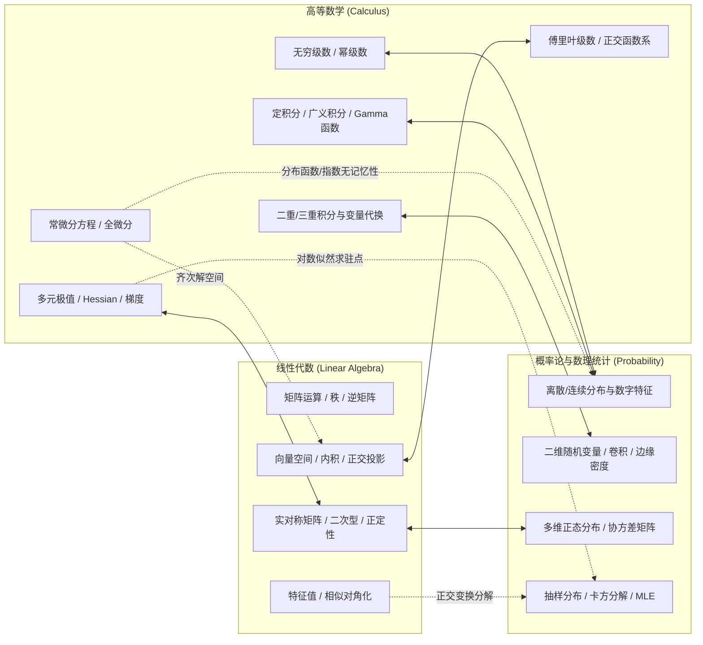
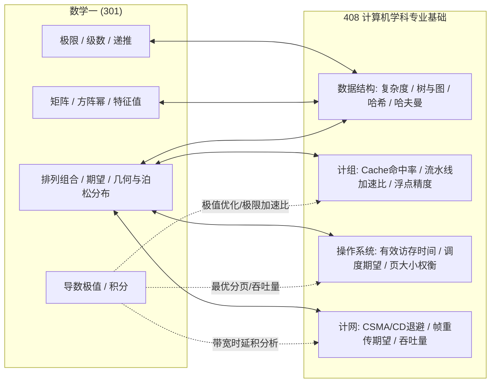

# 考研数学一（科目代码 301）知识点索引目录与大纲

> **文档定位**：面向个人学习与知识库建设的 **考研数学一（301）全三科知识点索引骨架（Index / Outline Only）**。本文仅收录章节结构、核心考点清单、考频权重、交互可视化候选标签（Mafs 2D / Three.js 3D）、三科及数一↔408 交叉关联图谱与教材目录映射，**不展开具体概念教程与例题推导**，便于后续按目录逐项填充笔记与构建可视化组件。
>
> **基准版本**：教育部教育考试院《全国硕士研究生招生考试数学（一）考试大纲》（2021 年题型与分值改制后定型，2022—2026 年主体结构保持稳定，2025—2026 年仅作极少量文字规范微调）。

---

## 一、试卷结构与宏观考情总览

### 1.1 基本考试参数

| 项目 | 说明 |
| :--- | :--- |
| **科目代码与名称** | 301 数学（一）（全国统一命题，教育部教育考试院命制） |
| **满分与时长** | 满分 **150 分**，考试时间 **180 分钟**（闭卷、笔试，不允许使用计算器） |
| **题型结构（2021 改制后）** | 共 **22 题**：**单项选择题** 10 题 × 5 分 = 50 分；**填空题** 6 题 × 5 分 = 30 分；**解答题（含证明题）** 6 题 = 70 分（第 17 题 10 分，第 18–22 题各 12 分） |
| **适用专业** | 工学门类对数学要求较高的绝大多数一级学科（含计算机科学与技术、软件工程、控制、电子、通信、机械、力学等）及管理科学与工程 |

### 1.2 三科分值、题号分配与近年趋势

| 科目 | 大纲规定占比 | 近年真题实测分值 | 选择题（5分/题） | 填空题（5分/题） | 解答题（10/12分） | 近年考情与命题特征 |
| :--- | :---: | :---: | :---: | :---: | :---: | :--- |
| **高等数学** | 约 **60%**（约 90 分） | **86 分**（57.3%）为主 | 第 1–4 题（20 分） | 第 11–14 题（20 分） | 第 17–20 题（10+12×3=46 分） | 选填重概念反例与细节辨析；大题核心锁定**中值定理/不等式证明、微分方程、多元极值/重积分、曲线曲面积分（数一重点）、无穷级数**。 |
| **线性代数** | 约 **20%**（约 30 分） | **32 分**（21.3%）为主 | 第 5–7 题（15 分） | 第 15 题（5 分） | 第 21 题（12 分） | 知识链条高度耦合；选填偏重抽象矩阵秩、相似/合同判定与向量相关性；第 21 题高度聚焦**特征值/特征向量、相似对角化、实对称矩阵与二次型**。 |
| **概率论与数理统计** | 约 **20%**（约 30 分） | **32 分**（21.3%）为主 | 第 8–10 题（15 分） | 第 16 题（5 分） | 第 22 题（12 分） | 计算与概念并重；第 22 题常考**二维随机变量分布/函数分布、数字特征综合**或**极大似然估计/矩估计/无偏性与抽样分布**。 |

> **近年大纲演进与卷种差异速览（2021–2026）**：
> - **2021 年（近年最大改制）**：客观题分值从 56 分大幅提升至 **80 分**（选 10×5 + 填 6×5），解答题由 9 题压缩至 **6 题**（70 分），单题容错率显著下降，对基本概念理解与计算一次准确率要求陡增。
> - **2022–2026 年（高度稳定）**：高数与线代考点无实质增减；2025/2026 年仅在概率论个别表述上作严谨化微调（如强调“掌握用事件独立性进行概率计算方法”）。
> - **数学一独有考点**：相比数学二/三，数一完整覆盖**向量代数与空间解析几何、三重积分、曲线/曲面积分与场论（格林/高斯/斯托克斯公式、散度与旋度）、傅里叶级数、欧拉方程、向量空间与过渡矩阵、区间估计与假设检验**，下文均以 `[数一独有]` 显式标注。

---

## 二、三科完整知识点索引大纲

> **图例说明**：
> - **考频/权重**：`★★★` 核心高频（大题/选填常客）｜`★★` 中频常考（选填或解答小问）｜`★` 基础/低频（偶发选填或概念铺垫）
> - **交互可视化候选标签**：
>   - `[Mafs 2D]`：强适合 2D 交互函数图像、微积分几何意义、平面区域、概率密度/分布曲线（基于 Mafs）
>   - `[Three.js 3D]`：强适合 3D 曲面、空间解析几何、多元微积分区域/向量场、三维线性变换（基于 Three.js）
> - **卷种标签**：`[数一独有]` 数学一专属考查内容
> - **章节编号**：主骨架严格对齐 **教育部考试院《数学（一）考试大纲》**（高数 8 章、线代 6 章、概率 8 章），每章头部标注对应经典教材章节。

---

### 模块一：高等数学（Advanced Mathematics，约 60% / 86–90 分）

#### 第 1 章 函数、极限、连续 `★★★`
> 教材映射：同济《高等数学》（上册）第 1 章
- **1.1 函数的概念与性质** `★`
  - 函数的定义、表示法、复合函数、反函数、分段函数、隐函数
  - 函数的四大性态：有界性、单调性、周期性、奇偶性 `[Mafs 2D]`
  - 基本初等函数及其图形、初等函数
- **1.2 极限的概念、性质与计算** `★★★`
  - 数列极限与函数极限的定义（$\varepsilon\text{-}N$、$\varepsilon\text{-}\delta$ 语言）、左右极限 `[Mafs 2D]`
  - 极限的唯一性、局部有界性、局部保号性、海涅归结原则
  - 极限四则运算法则与复合函数极限
  - 极限存在准则：夹逼准则（数列和式极限）、单调有界准则（递推数列极限）`★★★` `[Mafs 2D]`
  - 两个重要极限：$\lim_{x\to 0}\frac{\sin x}{x}=1$、$\lim_{x\to\infty}(1+\frac{1}{x})^x=e$
  - 无穷小量与无穷大量、无穷小阶的比较（高阶/低阶/同阶/等价）、常用等价无穷小代换 `★★★`
  - 未定式极限综合计算（$0/0, \infty/\infty, 0\cdot\infty, \infty-\infty, 1^\infty, 0^0, \infty^0$）`★★★`
- **1.3 函数的连续性与间断点** `★★`
  - 函数连续的定义、左右连续、初等函数连续性
  - 间断点分类：第一类（可去、跳跃）与第二类（无穷、振荡）`★★` `[Mafs 2D]`
  - 闭区间上连续函数的性质：有界性、最值定理、零点定理、介值定理 `★★`

#### 第 2 章 一元函数微分学 `★★★`
> 教材映射：同济《高等数学》（上册）第 2 章、第 3 章
- **2.1 导数与微分的概念** `★★★`
  - 导数的定义、左右导数、几何意义（切线斜率）与物理意义（瞬时速率）`[Mafs 2D]`
  - 可导、可微与连续的逻辑关系（含绝对值/分段点可导性判定）`★★★`
  - 平面曲线的切线方程与法线方程 `[Mafs 2D]`
  - 微分的定义、几何意义（线性主部）与一阶微分形式不变性 `[Mafs 2D]`
- **2.2 导数计算与高阶导数** `★★★`
  - 基本求导公式与四则运算法则
  - 复合函数求导（链式法则）、反函数求导
  - 隐函数求导法、对数求导法、参数方程所确定函数的求导（一阶与二阶）`★★★`
  - 高阶导数（归纳法、莱布尼茨公式、泰勒展开求 $n$ 阶导）`★★`
- **2.3 微分中值定理与泰勒公式** `★★★`
  - 费马引理、罗尔（Rolle）定理、拉格朗日（Lagrange）中值定理、柯西（Cauchy）中值定理 `★★★` `[Mafs 2D]`
  - 泰勒（Taylor）公式与麦克劳林（Maclaurin）公式（佩亚诺余项与拉格朗日余项）`★★★` `[Mafs 2D]`
  - 洛必达（L'Hôpital）法则及其使用条件
- **2.4 导数的几何应用与函数性态研究** `★★★`
  - 函数单调性判别与不等式证明 `★★★`
  - 极值（第一、二充分条件）、最值及应用题 `★★★` `[Mafs 2D]`
  - 曲线凹凸性、拐点判定 `★★★` `[Mafs 2D]`
  - 曲线渐近线（水平、铅直、斜渐近线）`★★` `[Mafs 2D]`
  - 方程根的存在性与个数讨论 `★★★`
  - 弧微分、曲率、曲率半径与曲率圆 `★` `[Mafs 2D]`

#### 第 3 章 一元函数积分学 `★★★`
> 教材映射：同济《高等数学》（上册）第 4 章、第 5 章、第 6 章
- **3.1 不定积分** `★★`
  - 原函数与不定积分的概念、原函数存在定理、基本积分表
  - 第一类换元法（凑微分）、第二类换元法（三角代换/根式代换/倒代换）`★★★`
  - 分部积分法（表格法与递推积分）`★★★`
  - 有理函数积分（部分分式）、三角函数有理式（万能代换）与简单无理函数积分 `★★`
- **3.2 定积分的概念、性质与计算** `★★★`
  - 定积分的定义（黎曼和极限，常与数列求和极限结合）`★★★` `[Mafs 2D]`
  - 可积的必要/充分条件、定积分基本性质（线性、区间可加、比较、估值、对称性/周期性）`★★★`
  - 定积分中值定理与推广
  - 变限积分函数（积分上限函数）的连续性与求导公式 `★★★`
  - 牛顿-莱布尼茨（Newton-Leibniz）公式、定积分换元与分部积分（含点火/华里士公式）`★★★`
- **3.3 反常积分（广义积分）** `★★`
  - 无穷区间上的反常积分与无界函数的反常积分（瑕积分）计算 `★★` `[Mafs 2D]`
  - 反常积分的敛散性判别法（比较审敛法、极限审敛法、$p$-积分基准）`★★`
  - $\Gamma$（Gamma）函数基本性质（跨概率论常用工具）`★★`
- **3.4 定积分的几何与物理应用** `★★★`
  - 元素法（微元法）思想
  - 平面图形面积（直角坐标、极坐标、参数方程）`★★★` `[Mafs 2D]`
  - 旋转体体积（绕坐标轴及任意平行/一般直线）与已知平行截面面积的立体体积 `★★★` `[Three.js 3D]`
  - 平面曲线弧长、旋转曲面侧面积 `★★` `[Mafs 2D]` `[Three.js 3D]`
  - 物理应用：变力做功、液体静压力、万有引力、质心/形心 `★`

#### 第 4 章 向量代数和空间解析几何 `★` `[数一独有]`
> 教材映射：同济《高等数学》（下册）第 8 章 ｜ 虽直接单考频率偏低，但是第 5/6 章多元微积分的必备几何底座
- **4.1 向量代数** `★` `[数一独有]`
  - 向量的线性运算、坐标表示、模与方向余弦 `[Three.js 3D]`
  - 数量积（点积）、向量积（叉积）、混合积的运算与几何意义（垂直/平行/共面判别）`[Three.js 3D]`
- **4.2 空间平面与直线** `★★` `[数一独有]`
  - 平面方程（点法式、一般式、截距式、三点式）`[Three.js 3D]`
  - 空间直线方程（一般式、对称式/点向式、参数式）`[Three.js 3D]`
  - 平面与平面、直线与直线、直线与平面的夹角及位置关系、点到平面/直线的距离、平面束方程 `★★` `[Three.js 3D]`
- **4.3 空间曲面与空间曲线** `★★` `[数一独有]`
  - 球面、柱面、旋转曲面（绕坐标轴及一般直线旋转的曲面方程）`★★` `[Three.js 3D]`
  - 常用二次曲面（椭球面、单/双叶双曲面、椭圆抛物面、双曲抛物面/马鞍面、锥面）的方程与图形 `★★` `[Three.js 3D]`
  - 空间曲线的一般方程与参数方程、空间曲线在坐标面上的投影曲线 `★★` `[Three.js 3D]`

#### 第 5 章 多元函数微分学 `★★★`
> 教材映射：同济《高等数学》（下册）第 9 章
- **5.1 多元函数的极限、连续、偏导数与全微分** `★★★`
  - 二元函数的几何意义、重极限与累次极限、二元函数连续性 `[Three.js 3D]`
  - 有界闭区域上多元连续函数的性质
  - 偏导数与高阶偏导数（混合偏导数相等的充分条件）`★★★`
  - 全微分的概念、可微的必要条件与充分条件（连续/偏导存在/可微/偏导连续四者关系辨析）`★★★` `[Three.js 3D]`
- **5.2 多元复合函数与隐函数求导** `★★★`
  - 多元复合函数链式法则（一阶与二阶偏导、抽象函数变换）`★★★`
  - 一阶全微分形式不变性
  - 隐函数存在定理与一个方程/方程组所确定的隐函数偏导数计算 `★★★`
- **5.3 多元函数微分学的几何应用与方向导数** `★★` `[数一独有]`
  - 空间曲线的切线与法平面、曲面的切平面与法线 `★★` `[Three.js 3D]`
  - 方向导数与梯度（Gradient）的定义、计算及几何意义（最速上升方向）`★★` `[Three.js 3D]`
- **5.4 多元函数的极值与最值** `★★★`
  - 二元函数的二阶泰勒公式（了解）
  - 无条件极值（驻点与二阶偏导数判别法 / Hessian 矩阵判别法）`★★★` `[Three.js 3D]`
  - 条件极值与拉格朗日乘数法（Lagrange Multipliers）`★★★` `[Three.js 3D]`
  - 有界闭区域上多元函数的最大值与最小值 `★★★`

#### 第 6 章 多元函数积分学 `★★★`
> 教材映射：同济《高等数学》（下册）第 10 章、第 11 章 ｜ 本章是**数一大题的皇冠与核心拉分点**
- **6.1 二重积分** `★★★`
  - 二重积分的概念、几何意义与性质（轮换对称性、奇偶对称性）`★★★` `[Three.js 3D]`
  - 直角坐标系下化为累次积分、**交换积分次序** `★★★` `[Mafs 2D]`
  - 极坐标系下的二重积分与一般变量代换（雅可比行列式）`★★★` `[Mafs 2D]`
- **6.2 三重积分** `★★` `[数一独有]`
  - 三重积分的概念与性质（对称性）
  - 直角坐标（先一后二/投影法、先二后一/截面法）`★★` `[Three.js 3D]`
  - 柱面坐标与球面坐标下的三重积分 `★★★` `[Three.js 3D]`
- **6.3 曲线积分** `★★★` `[数一独有]`
  - 第一类曲线积分（对弧长的曲线积分）：概念、对称性、参数化计算 `★★` `[Mafs 2D]` `[Three.js 3D]`
  - 第二类曲线积分（对坐标的曲线积分）：概念、物理意义（变力做功）、计算与两类曲线积分的关系 `★★★` `[Mafs 2D]` `[Three.js 3D]`
  - **格林（Green）公式**、平面曲线积分与路径无关的等价条件（含挖洞补线法）`★★★` `[Mafs 2D]`
  - 二元函数全微分求积（原函数求法）`★★`
- **6.4 曲面积分与场论初步** `★★★` `[数一独有]`
  - 第一类曲面积分（对面积的曲面积分）：概念、对称性与投影法计算 `★★★` `[Three.js 3D]`
  - 第二类曲面积分（对坐标的曲面积分）：有向曲面、物理意义（通量）、直接投影法与转换投影法 `★★★` `[Three.js 3D]`
  - **高斯（Gauss）公式**（散度定理，含补面法与奇点挖洞法）`★★★` `[Three.js 3D]`
  - **斯托克斯（Stokes）公式**（空间曲线积分 ↔ 曲面积分）`★★★` `[Three.js 3D]`
  - 向量场初步：散度（Divergence）与旋度（Curl）的计算与物理意义 `★★` `[Three.js 3D]`
- **6.5 重积分与线面积分的应用** `★`
  - 曲面面积、立体体积、变密度物体的质量、质心、转动惯量与引力 `★`

#### 第 7 章 无穷级数 `★★★`
> 教材映射：同济《高等数学》（下册）第 12 章
- **7.1 常数项级数** `★★★`
  - 级数收敛与发散的定义、收敛的必要条件、基本性质
  - 几何级数与 $p$-级数（调和级数）的敛散性
  - 正项级数审敛法：比较审敛法（及其极限形式）、比值审敛法（达朗贝尔）、根值审敛法（柯西）、积分审敛法 `★★★`
  - 交错级数与莱布尼茨（Leibniz）审敛法 `★★`
  - 任意项级数的绝对收敛与条件收敛（及其与加减乘运算的关系）`★★★`
- **7.2 幂级数** `★★★`
  - 函数项级数与收敛域基本概念
  - 幂级数的阿贝尔（Abel）定理、收敛半径、收敛区间与收敛域（端点敛散性检验）`★★★` `[Mafs 2D]`
  - 幂级数在收敛区间内的性质：和函数连续性、逐项求导与逐项积分 `★★★`
  - **求幂级数和函数**（构造微分方程/逐项求导积分法）与常数项级数求和 `★★★`
  - 函数展开成幂级数（直接展开法、间接展开法与常用初等函数麦克劳林展开式）`★★★` `[Mafs 2D]`
- **7.3 傅里叶级数** `★` `[数一独有]`
  - 函数系的正交性、以 $2\pi$ 或 $2l$ 为周期的函数的傅里叶（Fourier）级数展开 `★` `[Mafs 2D]`
  - 狄利克雷（Dirichlet）收敛定理（判断间断点/端点处傅里叶级数的收敛值）`★★` `[Mafs 2D]`
  - 奇延拓（正弦级数）与偶延拓（余弦级数）`★` `[Mafs 2D]`

#### 第 8 章 常微分方程 `★★★`
> 教材映射：同济《高等数学》（上册）第 7 章
- **8.1 一阶微分方程** `★★★`
  - 微分方程的阶、通解、特解、初始条件与积分曲线 `[Mafs 2D]`
  - 变量可分离方程、齐次微分方程（及可化为齐次的方程）`★★`
  - 一阶线性微分方程（常数变易法与通解公式）`★★★`
  - 伯努利（Bernoulli）方程、全微分方程（了解）`★★`
- **8.2 可降阶的高阶微分方程** `★★`
  - $y^{(n)}=f(x)$、$y''=f(x,y')$（不显含 $y$）、$y''=f(y,y')$（不显含 $x$）`★★`
- **8.3 高阶线性微分方程** `★★★`
  - 线性微分方程解的结构定理（齐次解空间、非齐次特解 + 齐次通解、叠加原理）`★★★`
  - 二阶及高于二阶的常系数齐次线性微分方程（特征方程法）`★★★`
  - 二阶常系数非齐次线性微分方程（自由项为 $P_m(x)e^{\lambda x}$ 与 $e^{\alpha x}[P_l(x)\cos\beta x + Q_n(x)\sin\beta x]$ 的待定系数法）`★★★`
  - **欧拉（Euler）方程**（换元 $x=e^t$ 化为常系数方程）`★` `[数一独有]`
- **8.4 微分方程综合应用** `★★★`
  - 结合变限积分、偏导数变换、几何条件（切线/面积/弧长）与物理/变化率模型建立并求解微分方程 `★★★` `[Mafs 2D]`

---

### 模块二：线性代数（Linear Algebra，约 20% / 30–32 分）

#### 第 1 章 行列式 `★★`
> 教材映射：同济《线性代数》第 1 章
- **1.1 行列式的概念与性质** `★★`
  - $n$ 阶行列式的定义（排列与逆序数）、几何意义（2D 面积 / 3D 体积缩放因子）`[Mafs 2D]` `[Three.js 3D]`
  - 行列式的核心性质（转置、换行变号、倍乘、拆分、倍加不变）
- **1.2 行列式展开与计算技巧** `★★`
  - 余子式与代数余子式、按行（列）展开定理及异乘变零性质 `★★`
  - 经典行列式模型：上/下三角、爪形（箭形）、行和相等、三对角（递推）、范德蒙德（Vandermonde）行列式、分块矩阵行列式 `★★`
  - 抽象矩阵行列式计算（结合特征值、相似、正交、伴随矩阵）`★★★`

#### 第 2 章 矩阵 `★★★`
> 教材映射：同济《线性代数》第 2 章、第 3 章（初等变换与秩）
- **2.1 矩阵运算与特殊矩阵** `★★`
  - 线性运算、矩阵乘法（不可交换性、矩阵乘法的线性变换几何意义）、转置、对称/反对称矩阵 `[Mafs 2D]` `[Three.js 3D]`
  - 方阵的幂（秩为 1 矩阵的幂、二项式展开、相似对角化求高次幂）`★★`
- **2.2 逆矩阵与伴随矩阵** `★★★`
  - 可逆的充要条件、逆矩阵的性质与求法（初等行变换、伴随矩阵、分块求逆）`★★★`
  - 伴随矩阵 $A^*$ 的定义、核心恒等式（$AA^* = |A|E$）与秩的关系 `★★★`
- **2.3 初等变换、初等矩阵与矩阵的秩** `★★★`
  - 初等行/列变换与初等矩阵（左行右列定理）`★★★`
  - 矩阵等价的定义与标准形
  - 矩阵的秩（Rank）的定义、核心不等式（和、积、分块、转置 $r(A^T A)=r(A)$、西尔维斯特不等式）`★★★`
  - 分块矩阵及其运算与求逆 `★★`

#### 第 3 章 向量 `★★★`
> 教材映射：同济《线性代数》第 4 章
- **3.1 向量组的线性相关性** `★★★`
  - $n$ 维向量的线性组合与线性表示（与非齐次线性方程组解的等价性）`★★★`
  - 线性相关与线性无关的定义、几何意义及判别定理（个数与维数、部分与整体、延伸与缩短、秩判别）`★★★` `[Mafs 2D]` `[Three.js 3D]`
  - 向量组的极大线性无关组、向量组的秩、向量组的等价（与矩阵等价的区别）`★★★`
- **3.2 向量空间与内积** `★★`
  - **向量空间、子空间、基、维数、坐标、基变换与过渡矩阵** `★★` `[数一独有]` `[Mafs 2D]` `[Three.js 3D]`
  - 向量内积、长度（范数）、夹角与正交向量组
  - 施密特（Gram-Schmidt）正交化方法 `★★` `[Three.js 3D]`
  - 正交矩阵的定义、性质与几何意义（保长保角刚体变换）`★★` `[Mafs 2D]` `[Three.js 3D]`

#### 第 4 章 线性方程组 `★★★`
> 教材映射：同济《线性代数》第 3 章、第 4 章
- **4.1 方程组解的判定** `★★★`
  - 克拉默（Cramer）法则
  - 齐次线性方程组 $Ax=0$ 有非零解的充要条件
  - 非齐次线性方程组 $Ax=b$ 无解、唯一解、无穷多解的充要条件（系数矩阵与增广矩阵的秩）`★★★`
- **4.2 解的结构与求解** `★★★`
  - 齐次线性方程组的基础解系（维度 $n - r(A)$）与通解结构 `★★★` `[Three.js 3D]`
  - 非齐次线性方程组的通解结构（特解 + 导出组通解）`★★★`
  - 含参数方程组的分类讨论、公共解与同解方程组问题 `★★★`
  - 矩阵方程 $AX=B$ 求解 `★★`

#### 第 5 章 矩阵的特征值和特征向量 `★★★`
> 教材映射：同济《线性代数》第 5 章
- **5.1 特征值与特征向量** `★★★`
  - 特征值与特征向量的定义、几何意义（变换下的不变方向）、特征多项式 `[Mafs 2D]` `[Three.js 3D]`
  - 核心性质（迹 $\sum\lambda_i=\mathrm{tr}(A)$、行列式 $\prod\lambda_i=|A|$、多项式矩阵 $f(A)$ 的特征值、不同特征值对应特征向量线性无关）`★★★`
- **5.2 相似矩阵与相似对角化** `★★★`
  - 相似矩阵的定义、性质与不变量（秩、行列式、迹、特征多项式）`★★★`
  - 矩阵可相似对角化的充要条件（$n$ 个线性无关特征向量 / 几何重数等于代数重数）与充分条件 `★★★`
  - 求可逆矩阵 $P$ 使 $P^{-1}AP=\Lambda$、反求原矩阵 $A$ `★★★`
- **5.3 实对称矩阵的对角化** `★★★`
  - 实对称矩阵的核心性质（特征值全为实数、不同特征值的特征向量正交、必可正交相似对角化）`★★★`
  - 构造正交矩阵 $Q$ 使 $Q^T A Q = \Lambda$（结合施密特正交化）`★★★`

#### 第 6 章 二次型 `★★★`
> 教材映射：同济《线性代数》第 5 章
- **6.1 二次型及其标准形与规范形** `★★★`
  - 二次型的矩阵表示（实对称矩阵 $A$）、二次型的秩 `[Three.js 3D]`
  - 合同变换与合同矩阵（与等价、相似的关系辨析）`★★★`
  - 化二次型为标准形：**正交变换法**（保几何形状，特征值为系数）与**配方法**（拉格朗日配方法）`★★★` `[Three.js 3D]`
  - 惯性定理、正/负惯性指数与规范形 `★★★`
- **6.2 正定二次型与正定矩阵** `★★★`
  - 正定二次型与正定矩阵的定义、几何意义（向上开口的抛物面/椭球面）`[Three.js 3D]`
  - 正定的充要条件（正惯性指数 $=n$、特征值全大于 0、合同于 $E$、各阶顺序主子式全大于 0、存在可逆阵 $C$ 使 $A=C^TC$）`★★★`
  - 正定的必要条件（$a_{ii}>0, |A|>0$）与抽象正定矩阵证明 `★★`

---

### 模块三：概率论与数理统计（Probability Theory & Mathematical Statistics，约 20% / 30–32 分）

#### 第 1 章 随机事件和概率 `★★`
> 教材映射：浙大《概率论与数理统计》第 1 章
- **1.1 随机事件及其运算** `★`
  - 样本空间、随机事件、事件关系（包含、互斥、对立）与运算（并、交、差、德摩根律）
- **1.2 概率的定义与基本计算** `★★`
  - 概率的公理化定义与基本性质（加法公式、减法公式、单调性）
  - 古典概型与几何概型 `★★` `[Mafs 2D]`
- **1.3 条件概率、全概率与贝叶斯公式** `★★★`
  - 条件概率与乘法公式 `★★`
  - **全概率公式**与**贝叶斯（Bayes）公式** `★★★`
  - 事件的独立性（两两独立 vs 相互独立）与伯努利概型（$n$ 重独立重复试验）`★★`

#### 第 2 章 随机变量及其分布 `★★★`
> 教材映射：浙大《概率论与数理统计》第 2 章
- **2.1 分布函数与两类随机变量** `★★★`
  - 分布函数 $F(x)=P\{X\le x\}$ 的充要性质（单调不减、右连续、规范性）`★★★` `[Mafs 2D]`
  - 离散型随机变量及其分布律 `★★` `[Mafs 2D]`
  - 连续型随机变量及其概率密度 $f(x)$（非负性、归一性、与 $F(x)$ 的微积分关系）`★★★` `[Mafs 2D]`
- **2.2 常见一维概率分布** `★★★`
  - 常见离散分布：0-1 分布、二项分布 $B(n,p)$、几何分布 $G(p)$、超几何分布、泊松分布 $P(\lambda)$ `★★★` `[Mafs 2D]`
  - 常见连续分布：均匀分布 $U(a,b)$、指数分布 $E(\lambda)$（**无记忆性**）、正态分布 $N(\mu,\sigma^2)$ 与标准正态分布 $\Phi(x)$ `★★★` `[Mafs 2D]`
- **2.3 随机变量函数的分布** `★★★`
  - 离散型函数的分布、连续型函数的分布（分布函数法与公式法，含分段/非单调函数）`★★★` `[Mafs 2D]`

#### 第 3 章 多维随机变量及其分布 `★★★`
> 教材映射：浙大《概率论与数理统计》第 3 章
- **3.1 二维随机变量的联合、边缘与条件分布** `★★★`
  - 二维联合分布函数 $F(x,y)$ 的性质
  - 二维离散型：联合分布律、边缘分布律、条件分布律 `★★`
  - 二维连续型：联合概率密度 $f(x,y)$、边缘密度 $f_X(x), f_Y(y)$、条件密度 $f_{X|Y}(x|y)$ `★★★` `[Three.js 3D]`
  - 随机变量的独立性判定（联合 = 边缘乘积）`★★★`
- **3.2 常见二维分布** `★★`
  - 二维均匀分布（面积比）、二维正态分布 $N(\mu_1,\mu_2;\sigma_1^2,\sigma_2^2;\rho)$ 及其边缘/独立性/线性组合性质 `★★★` `[Three.js 3D]`
- **3.3 多维随机变量函数的分布** `★★★`
  - 离散 + 离散、连续 + 连续（分布函数法、**卷积公式** $Z=X+Y$、商/积分布）`★★★` `[Mafs 2D]`
  - 离散 + 连续混合型（全概率公式法）`★★★`
  - 最大值 $M=\max(X,Y)$ 与最小值 $N=\min(X,Y)$ 的分布 `★★`
  - 常见分布的可加性（二项、泊松、正态、$\chi^2$）`★★`

#### 第 4 章 随机变量的数字特征 `★★★`
> 教材映射：浙大《概率论与数理统计》第 4 章
- **4.1 数学期望与方差** `★★★`
  - 数学期望 $E(X)$ 的定义、性质与随机变量函数 $E[g(X)], E[g(X,Y)]$ 的计算 `★★★`
  - 方差 $D(X)$、标准差的定义、计算公式 $D(X)=E(X^2)-[E(X)]^2$ 与性质 `★★★`
  - 切比雪夫（Chebyshev）不等式 `★★`
  - 常见分布的期望与方差速查（二项/泊松/几何/均匀/指数/正态/$\chi^2$）`★★★`
- **4.2 协方差、相关系数与矩** `★★★`
  - 协方差 $\mathrm{Cov}(X,Y)$ 与相关系数 $\rho_{XY}$ 的定义、性质与线性相关性刻画 `★★★` `[Mafs 2D]`
  - **独立性与不相关性的关系**（一般独立 $\Rightarrow$ 不相关，二维正态下二者等价）`★★★`
  - 原点矩、中心矩与协方差矩阵（了解）`★`

#### 第 5 章 大数定律和中心极限定理 `★`
> 教材映射：浙大《概率论与数理统计》第 5 章
- **5.1 依概率收敛与大数定律** `★`
  - 依概率收敛的定义与性质
  - 切比雪夫大数定律、伯努利大数定律、辛钦（Khinchine）大数定律 `★` `[Mafs 2D]`
- **5.2 中心极限定理** `★★`
  - 列维-林德伯格（Lindeberg-Lévy）独立同分布中心极限定理 `★★` `[Mafs 2D]`
  - 棣莫弗-拉普拉斯（De Moivre-Laplace）定理（二项分布的正态近似）`★★` `[Mafs 2D]`

#### 第 6 章 数理统计的基本概念 `★★`
> 教材映射：浙大《概率论与数理统计》第 6 章
- **6.1 总体、样本与统计量** `★★`
  - 简单随机样本、统计量、经验分布函数
  - 样本均值 $\bar{X}$、样本方差 $S^2$、样本 $k$ 阶原点矩与中心矩（及数字特征）`★★★`
- **6.2 三大抽样分布与正态总体抽样分布定理** `★★★`
  - $\chi^2$ 分布、$t$ 分布、$F$ 分布的构造定义、基本性质与上侧 $\alpha$ 分位数 `★★★` `[Mafs 2D]`
  - **正态总体的常用抽样分布定理**（$\bar{X}$ 与 $S^2$ 的独立性、$\frac{(n-1)S^2}{\sigma^2}\sim\chi^2(n-1)$、单/双正态总体的 $t$ 与 $F$ 统计量）`★★★`

#### 第 7 章 参数估计 `★★★`
> 教材映射：浙大《概率论与数理统计》第 7 章
- **7.1 点估计** `★★★`
  - 矩估计法（单参数与双参数）`★★★`
  - **最大似然估计法（MLE）**（求导法与单调/边界值法）`★★★` `[Mafs 2D]`
  - 估计量的评选标准：**无偏性**（高频）、**有效性**（方差比较）、**一致性（相合性）**`★★★`
- **7.2 区间估计** `★` `[数一独有]`
  - 置信区间与枢轴量法的基本概念 `[Mafs 2D]`
  - 单个正态总体的均值（$\sigma^2$ 已知/未知）与方差的置信区间 `★★` `[数一独有]`
  - 两个正态总体的均值差与方差比的置信区间 `★` `[数一独有]`

#### 第 8 章 假设检验 `★` `[数一独有]`
> 教材映射：浙大《概率论与数理统计》第 8 章
- **8.1 假设检验的基本概念** `★` `[数一独有]`
  - 原假设 $H_0$ 与备择假设 $H_1$、显著性水平 $\alpha$、拒绝域、双边检验与单边检验 `[Mafs 2D]`
  - 两类错误：第一类错误（弃真，$\alpha$）与第二类错误（取伪，$\beta$）及其权衡关系 `★★` `[数一独有]` `[Mafs 2D]`
- **8.2 正态总体的假设检验** `★` `[数一独有]`
  - 单个正态总体的均值检验（$Z$ 检验 / $t$ 检验）与方差检验（$\chi^2$ 检验）`★` `[数一独有]`
  - 两个正态总体的均值差检验与方差比检验（$F$ 检验）`★` `[数一独有]`

---

## 三、跨科交叉关联图谱（Cross-Course & Math I ↔ 408 Connections）

考研数学一的高阶综合题（及后续专业课/408 学习）高度依赖跨学科知识迁移。本节梳理**数学一内部三科关联**与**数学一 ↔ 408 跨考纲关联**，建议在个人知识库中以双向链接（Backlinks）或全局 Tag 串联。

### 3.1 数学一内部三科交叉关联图

### 3.2 数学一内部五大核心交叉专题对照表

| 交叉专题 | 高等数学 | 线性代数 | 概率论与数理统计 | 典型综合考法与关联机制 |
| :--- | :--- | :--- | :--- | :--- |
| **1. 级数、反常积分与一维概率** | 幂级数求和（逐项求导/积分）、反常积分、$\Gamma(n)=(n-1)!$、$\int_{-\infty}^{+\infty}e^{-x^2}dx=\sqrt{\pi}$ | — | 离散分布归一性与期望方差（几何/泊松/二项）、连续分布归一化常数与高阶矩 | 利用幂级数求几何/泊松分布的 $E(X), D(X)$；利用 $\Gamma$ 函数秒算指数分布与 $\chi^2$ 分布的高阶原点矩。 |
| **2. 二重积分与二维随机变量** | 二重积分区域划分、交换积分次序、极坐标代换、雅可比行列式 | 线性变换的行列式（面积/体积缩放因子） | 二维连续型联合/边缘/条件密度、$Z=X+Y$ 卷积公式、二维均匀/正态概率计算 | 二维概率大题本质是带概率意义的二重积分计算；线性变换下的联合密度公式直接依赖雅可比行列式。 |
| **3. 矩阵、二次型与多元极值/统计** | 多元函数二阶泰勒展开、无条件极值判别（二阶偏导 Hessian 矩阵 $H$） | 实对称矩阵、正交相似对角化、二次型标准形、**正定性判别**、惯性定理 | 多维正态分布的协方差矩阵 $\Sigma$（半正定/正定）、**二次型分布与 $\chi^2$ 自由度分解**（如 $(n-1)S^2/\sigma^2$） | 二元极值判别 $AC-B^2>0, A>0$ 即 2 阶 Hessian 矩阵顺序主子式全正；样本方差 $\chi^2(n-1)$ 的本质是秩为 $n-1$ 的幂等二次型正交对角化。 |
| **4. 微分方程与线性空间/概率模型** | 线性微分方程解的结构定理、分离变量与一阶线性方程、偏导数与全微分 | 齐次线性方程组基础解系、解空间维数与线性叠加原理 | 分布函数与概率密度的微积分互转、指数分布的无记忆性方程 $G(x+y)=G(x)G(y)$、微分方程求未知密度 | $n$ 阶齐次线性微分方程通解即 $n$ 维向量空间；极大似然估计（MLE）求驻点本质为多元微分学极值/边界最值问题。 |
| **5. 内积、正交性与傅里叶展开** | 傅里叶级数三角函数系正交性、曲线/曲面投影 | 欧氏空间内积、施密特正交化、正交基坐标分解 | 零均值随机变量以 $\mathrm{Cov}(X,Y)$ 为内积（不相关即正交）、最小均方误差估计 | 傅里叶系数本质是函数在无穷维正交三角基上的内积投影，与有限维向量空间的正交基坐标展开完全同构。 |

### 3.3 数学一 ↔ 408（计算机专业基础）跨考纲关联图谱

面向同时备考**数学一（301）+ 408** 的计算机考研学习者，两门统考科目在底层数学建模上存在大量天然锚点：

| 数学一模块 | 对应 408 科目与考点 | 具体数学建模与关联说明 |
| :--- | :--- | :--- |
| **概率论：排列组合、数学期望、几何分布、条件概率** | **DS** 查找与排序平均时间复杂度、哈希冲突与装填因子；**CO/OS** Cache/TLB/缺页有效访存时间（EAT）；**CN** CSMA/CD 二进制指数退避冲突概率、不可靠信道帧重传期望次数 | 快速排序/折半查找/哈希探测的 ASL 本质是离散随机变量的**数学期望**；Cache/TLB 多级命中耗时为条件期望展开；每次传输成功概率为 $p$ 时的期望发送次数 $1/p$ 直接对应**几何分布期望**。 |
| **概率论：期望码长与信息视角** | **DS** 哈夫曼（Huffman）树与带权路径长度 WPL | 频率归一化后，哈夫曼编码的平均码长即为离散随机变量编码长度的**数学期望**。 |
| **线性代数：矩阵乘法、方阵幂、对称/稀疏矩阵** | **DS** 图的邻接矩阵与路径计数、特殊矩阵压缩存储 | 设无权图邻接矩阵为 $A$，则 $A^k$ 的元素 $(A^k)_{ij}$ 精确等于顶点 $i$ 到 $j$ 长度为 $k$ 的路径条数；无向图邻接矩阵为**实对称矩阵**（对应谱图理论与压缩存储）。 |
| **高等数学：极限、级数求和（等比/调和级数）** | **DS** 算法渐进时间复杂度（$O, \Omega, \Theta$）、递归树求和、满二叉树/B 树结点总数 | 渐进阶 $O(\cdot)$ 本质是高数中的**无穷大阶的比较**；满 $k$ 叉树与循环折半求和为**等比级数**；快排平均比较次数与哈希探测推导涉及**调和级数** $\sum 1/k \approx \ln n$。 |
| **高等数学：导数极值与极限分析** | **CO** 流水线吞吐率与加速比极限；**OS** 最佳页面大小权衡；**CN** TCP 吞吐量与信道利用率分析 | 流水线任务数 $n\to\infty$ 时的最大加速比对应**函数极限**；OS 内部碎片与页表开销之和最小化对应**一元函数求导取极值**。 |

---

## 四、经典教材 vs 考试大纲目录对照与交互可视化规划

### 4.1 三科权威教材与考纲/主流辅导体系对照

| 科目 | 经典大学教材（权威蓝本） | 经典教材目录特点 | 考纲 / 主流复习全书体系特点 | 关键差异与使用建议 |
| :--- | :--- | :--- | :--- | :--- |
| **高等数学** | 同济大学数学科学学院《高等数学（第 7 版 / 第 8 版）》（上、下册，高教社） | 共 **12 章**：上册 1–7 章（含第 7 章微分方程），下册 8–12 章（空间解析几何 → 多元微分 → 重积分 → 曲线曲面积分 → 无穷级数） | 考纲合并为 **8 章**（将上册 2–3 章合为一元微分、4–6 章合为一元积分、下册 10–11 章合为多元积分，并将微分方程置末） | 同济教材中**差分方程、最小二乘法、一致收敛性深入证明、物理应用过偏小节**不在数一考纲内；建议主导航按**考纲 8 章**组织，查定义与定理证明回溯同济对应章节。 |
| **线性代数** | 同济大学数学系《工程数学 线性代数（第 6 版 / 第 7 版）》（高教社） | 共 **6 章**（第 6 章“线性空间与线性变换”较抽象），将初等变换与线性方程组合在第 3 章，特征值与二次型合在第 5 章 | 考纲为 **6 章**（行列式 → 矩阵 → 向量[含向量空间] → 线性方程组 → 特征值与特征向量 → 二次型） | 同济第 6 章中仅**向量空间、基、维数、坐标与过渡矩阵**属于数一考纲（一般线性变换不考）；考纲 6 章划分更贴合真题综合解题逻辑。 |
| **概率论与数理统计** | 浙江大学盛骤等《概率论与数理统计（第 4 版 / 第 5 版）》（高教社） | 共 **12–14 章**（后半部分含方差分析、回归分析、随机过程、马尔可夫链等） | 考纲为 **8 章**，与浙大教材**前 8 章一一精准对应** | 浙大教材第 9 章及以后（方差分析、一元回归、随机过程等）**均不在考研数学一范围内**；前 8 章结构与考纲几乎完全同构。 |

### 4.2 个人站点交互可视化高优先级规划（Mafs 2D & Three.js 3D）

结合本文第二节的可视化标注，以下主题最能通过交互式图形建立直觉，适合作为个人网站数学一知识库的首批可视化组件：

| 渲染引擎 | 优先开发专题（Top Candidates） | 核心交互设计方向 |
| :--- | :--- | :--- |
| **`Mafs 2D`** | 1. 极限 $\varepsilon\text{-}\delta$ 与间断点分类 2. 导数切线、微分线性主部与泰勒多项式逼近 3. 微分中值定理（罗尔/拉格朗日几何割线与切线） 4. 黎曼和定积分、二重积分直角/极坐标区域切换 5. 幂级数收敛区间与傅里叶级数部分和吉布斯现象 6. 2D 线性变换矩阵（行列式面积缩放、特征向量不变方向） 7. 常见概率分布 PDF/CDF 调参（正态/二项/泊松/$\chi^2$/$t$/$F$）、中心极限定理动态演示、假设检验两类错误（$\alpha/\beta$ 面积权衡） | 滑块调节阶数 $n$、分布参数 $(\mu,\sigma,\lambda,\nu)$、置信水平 $1-\alpha$；拖拽点实时观察切线/线性变换基向量变化。 |
| **`Three.js 3D`** | 1. 常用二次曲面家族（马鞍面、单/双叶双曲面、抛物面）与旋转曲面生成 2. 二元函数偏导切平面、梯度方向导数与无条件/拉格朗日条件极值 3. 三重积分（柱面/球面坐标体元）与第一/二类曲线曲面积分（有向曲面法向量与通量） 4. 3D 向量场散度/旋度与高斯/斯托克斯公式几何直观 5. 3D 线性变换、特征空间与二次型标准形（正定椭球面 vs 不定双曲面） 6. 二维正态分布联合密度曲面与边缘分布投影（调节相关系数 $\rho$） | 鼠标自由旋转缩放视角、切片平面控制、参数滑块动态形变曲面与向量箭头场。 |

---

## 五、参考来源（Sources）

1. **官方考试大纲**：教育部教育考试院（原教育部考试中心），《全国硕士研究生招生考试数学（一）考试大纲》（2021 年题型与分值结构改革版及 2024—2026 年历年大纲汇总，高等教育出版社）。
2. **高等数学经典教材**：同济大学数学科学学院（原数学系），《高等数学（第 7 版 / 第 8 版）》（上、下册），高等教育出版社。
3. **线性代数经典教材**：同济大学数学系，《工程数学 线性代数（第 6 版 / 第 7 版）》，高等教育出版社。
4. **概率论与数理统计经典教材**：盛骤、谢式千、潘承毅（浙江大学），《概率论与数理统计（第 4 版 / 第 5 版）》，高等教育出版社。
5. **主流考研复习体系与真题考情**：李永乐/王式安/武忠祥《考研数学复习全书（数学一）》、张宇《考研数学基础/强化 30 讲（数学一）》及 2021—2025 年全国统考数学一真题题型、题号与分值分布统计。
