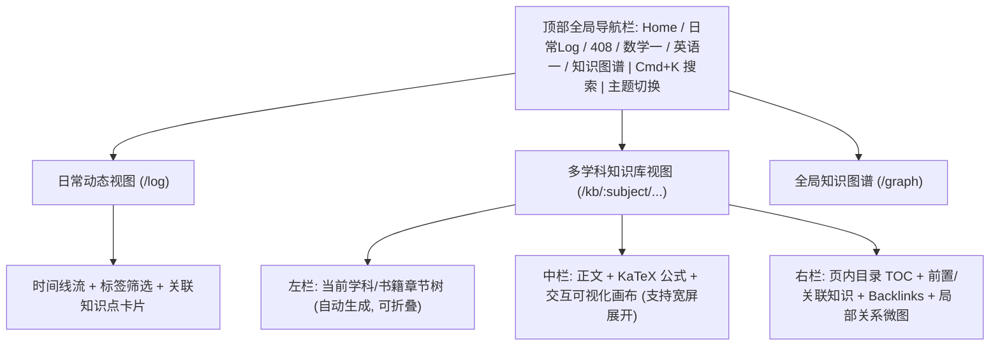

# 个人网站与考研知识库技术选型与架构调研报告

> **调研范围**：面向“个人日常动态（Daily Log） + 考研多学科知识库（408 / 数学一 / 英语一）”的纯静态展示站点，重点评估强可视化/分步交互、AI Agent 长期增量编写、单知识点高内聚可插拔、跨科引用与知识图谱、以及数学公式与图表渲染能力。  
> **信息来源原则**：本报告所有核心技术结论均基于框架与工具的官方文档、官方仓库及架构规范（Primary Sources）。

---

## 摘要与最终推荐方案 (Executive Summary)

针对本项目“**纯静态展示 + AI Agent 驱动内容与交互组件 + 多学科深度可视化 + 跨科知识网络**”的复合需求，综合评估后推荐采用以下技术栈：

| 架构层级 | 推荐选型 | 核心理由 |
| :--- | :--- | :--- |
| **站点框架** | **Custom Astro (v5+ Content Layer API + MDX + Islands)** | 默认零 JS 输出保证极速首屏；通过 Islands 架构（`client:visible` / `client:only`）精确按需加载 React/3D 交互岛；Content Layer API + Zod Schema 原生支持目录共置与强类型引用校验；相比 Starlight 更适合混合“个人日常流 + 多学科知识库 + 自定义反向链接/图谱”的自由布局。 |
| **交互 UI 运行时** | **React + TypeScript + Tailwind CSS** | 科学计算与可视化生态（Mafs、R3F、Motion、D3）几乎全部以 React 为一等公民；同时也是 AI Agent 生成高质量交互式教学组件成功率最高的技术栈。 |
| **2D/3D 可视化层** | **Motion + D3（仅计算） + Mafs + Three.js / React Three Fiber (`@react-three/fiber` + `@react-three/drei`)** | 覆盖全部学科场景：408 算法/系统原理分步动画（Motion + D3/SVG）、数一 2D 函数与线性变换（Mafs）、数一多元微积分曲面与 3D 空间变换（R3F）。 |
| **公式与静态图表** | **`remark-math` + `rehype-katex` + `Mermaid`（构建期 SVG）** | KaTeX 在构建期直接编译为静态 HTML，零客户端解析抖动；Mermaid 覆盖流程图、状态机、计网时序图等静态图示。 |
| **内容组织与关联** | **Co-located Page Bundles + Astro `reference()` + 构建期 Backlinks 图谱与断链校验** | 每个知识点独立文件夹（`index.mdx` + 局部 `_Widget.tsx`），AI 增删改单点无需触碰全局配置；构建期自动生成侧边栏、双向链接并阻断死链。 |
| **站内搜索** | **Pagefind** | 零后端、构建期生成的静态分片索引，天然适配纯静态部署（GitHub Pages / Cloudflare Pages / Vercel）。 |

---

## 一、站点与框架层对比 (Site & Framework Layer)

### 1.1 候选方案深度分析

#### A. Astro（Custom Astro vs. Astro Starlight）
Astro 的核心设计是 **Islands Architecture（群岛架构）** 与 **Content Layer API**：
- **默认零 JS 与按需水合**：Markdown / MDX 页面默认编译为纯静态 HTML，仅对显式标注了 `client:*` 指令（如 `client:visible`、`client:only="react"`）的交互组件发送 JavaScript ([Astro Islands Docs](https://docs.astro.build/en/concepts/islands/))。这意味着即便一个知识点内嵌了重量级 Three.js 场景，也不影响未滚动到该区域或其他纯文本页面的加载性能。
- **Content Layer API 与类型安全**：通过 `src/content.config.ts` 中的 `defineCollection` 与 `glob` loader，可以对任意嵌套目录的 `.md`/`.mdx` 文件进行 Zod Schema 校验，并原生提供 `reference()` 函数在构建期校验集合间引用 ([Astro Content Collections](https://docs.astro.build/en/guides/content-collections/))。
- **Custom Astro vs. Starlight 的权衡**：
  - **Astro Starlight** ([starlight.astro.build](https://starlight.astro.build/)) 是 Astro 官方文档主题，开箱即用侧边栏自动生成、Pagefind 搜索、暗色模式、响应式目录，且拥有 `starlight-links-validator` ([GitHub](https://github.com/HiDeoo/starlight-links-validator)) 和 `starlight-utils`（多侧边栏切换）等成熟插件。
  - **局限**：Starlight 面向标准“技术文档”，默认假设全局单一文档树 ([Starlight Sidebar Docs](https://starlight.astro.build/guides/sidebar/))。要实现本项目所需的**“个人日常时间线流 + 408/数一/英一多学科切换 + 右侧反向链接/知识图谱面板 + 宽屏可视化画布”**，在 Starlight 中需要大量覆盖内部组件（Component Overrides，如 `Sidebar.astro`、`PageFrame.astro`），反而会受限于 Starlight 内部 Props 变更风险 ([Starlight Overrides](https://starlight.astro.build/guides/overriding-components/))。
  - **结论**：若想以最小前期成本启动纯文档站，Starlight 是极佳起点；但为了长期自由演进混合形态（日常 Log + 多学科知识库 + 知识图谱），**基于 Custom Astro 自行搭建轻量三栏布局**维护成本更低、耦合度更小。

#### B. VitePress（Vue 3 + Markdown）
- **核心机制**：每个 Markdown 文件会被编译为 Vue SFC，可在 `.md` 中直接使用 `<script setup>` 导入 Vue 组件 ([VitePress: Using Vue in Markdown](https://vitepress.dev/guide/using-vue))。VitePress 利用 Vue 3 编译器对纯静态内容做静态提升，并采用“首屏 SSG + 后续 SPA 路由切换”的混合模式（亦提供实验性 `--mpa` 零 JS 模式）([VitePress MPA Mode](https://vitepress.dev/guide/mpa-mode))。
- **公式支持**：内置 `markdown: { math: true }` 支持 MathJax，或通过 `@vscode/markdown-it-katex` 接入 KaTeX ([VitePress Markdown Extensions](https://vitepress.dev/guide/markdown#math-equations))。
- **主要短板**：强绑定 Vue 生态。虽然 Vue 也有 TresJS 等 3D 封装，但在**数学交互可视化（如 Mafs）**、**声明式物理动画（Motion）** 以及 **AI Agent 生成复杂 STEM 交互演示的生态成熟度**上，明显弱于 React 生态；且缺乏像 Astro Content Layer `reference()` 那样开箱即用的强类型内容图谱 Schema 体系。

#### C. Next.js Static Export + Fumadocs / Nextra
- **核心机制**：Next.js 支持 `output: 'export'` 生成纯静态 `out/` 目录 ([Next.js Static Exports](https://nextjs.org/docs/app/building-your-application/deploying/static-exports))。**Fumadocs** ([fumadocs.dev](https://fumadocs.dev/)) 与 **Nextra** ([nextra.site](https://nextra.site/)) 均基于 Next.js + MDX，提供精美的文档 UI 与静态导出能力（Nextra 静态导出需配置 `images: { unoptimized: true }`，Fumadocs 静态导出需切换为 Static Search）。
- **主要短板**：
  - 即便是纯静态文章页，Next.js App Router / Pages Router 仍需向浏览器下发 React Runtime 与路由水合脚本，无法做到 Astro 级别的“文本页零 JS + 组件级 `client:visible` 隔离”。
  - Next.js 的核心优势在于 SSR / Server Actions / API Routes 等全栈能力，对于**纯只读静态站点**属于架构过重（Over-engineering），构建与依赖复杂度高于 Astro。

#### D. Quartz 4（Obsidian 风格数字花园生成器）
- **核心机制**：专为 Obsidian Vault 设计的开源 SSG ([quartz.jzhao.xyz](https://quartz.jzhao.xyz/))，开箱即用 Wikilinks (`[[Note]]`)、反向链接（Backlinks）、悬停预览（Popover Preview）以及交互式局部/全局关系图谱（Graph View）([Quartz Features](https://quartz.jzhao.xyz/features/graph-view))。
- **决定性短板（不适合本项目核心需求）**：
  - Quartz 4 底层使用 **Preact** 做静态 HTML 编译，并依赖 `micromorph` 实现客户端 SPA 局部 DOM 替换，**不原生支持 MDX + 任意有状态 React/Three.js 交互组件的水合**。
  - 在 Markdown 中强行嵌入交互组件容易在 SPA 路由切换后丢失状态或事件监听，官方推荐的交互方式是编写全局注册的 `.inline.ts` 原生脚本或自定义 Quartz Component ([Quartz Creating Components](https://quartz.jzhao.xyz/advanced/creating-components))。这与本项目“**每个知识点可独立内嵌定制 2D/3D React 交互演示**”的核心诉求存在根本冲突。

---

### 1.2 框架层综合对比矩阵

| 评估维度 | Custom Astro | Astro Starlight | VitePress | Next.js + Fumadocs/Nextra | Quartz 4 |
| :--- | :---: | :---: | :---: | :---: | :---: |
| **富可视化与 2D/3D 交互** | ⭐⭐⭐⭐⭐<br/>(原生 React Islands + 任意 WebGL) | ⭐⭐⭐⭐⭐<br/>(同 Astro) | ⭐⭐⭐⭐<br/>(仅限 Vue 生态，缺 Mafs 等) | ⭐⭐⭐⭐⭐<br/>(原生 React 生态) | ⭐⭐<br/>(无原生 MDX/React 状态水合) |
| **纯静态性能与隔离性** | ⭐⭐⭐⭐⭐<br/>(0 JS 默认 + `client:visible`) | ⭐⭐⭐⭐⭐<br/>(同 Astro) | ⭐⭐⭐⭐<br/>(Vue 静态优化 + SPA) | ⭐⭐⭐<br/>(全页 React Runtime 水合) | ⭐⭐⭐⭐⭐<br/>(极轻量静态页) |
| **单点可插拔 / AI 编写友好** | ⭐⭐⭐⭐⭐<br/>(目录共置 + Zod 强校验) | ⭐⭐⭐⭐<br/>(受限文档目录约定) | ⭐⭐⭐⭐<br/>(文件即路由，但缺强 Schema) | ⭐⭐⭐⭐<br/>(MDX + App Router 路由) | ⭐⭐⭐⭐<br/>(纯 MD 极简，但交互组件耦合) |
| **跨科引用与知识图谱** | ⭐⭐⭐⭐<br/>(`reference()` + 轻量自建图谱) | ⭐⭐⭐⭐<br/>(同左 + 官方生态断链插件) | ⭐⭐⭐<br/>(需自建插件) | ⭐⭐⭐<br/>(需自建图谱与校验) | ⭐⭐⭐⭐⭐<br/>(开箱即用双链/图谱/悬停) |
| **混合形态（日常 + 知识库）** | ⭐⭐⭐⭐⭐<br/>(完全自由定制布局) | ⭐⭐⭐<br/>(偏向纯文档，改造有阻力) | ⭐⭐⭐<br/>(偏文档，改造需覆写主题) | ⭐⭐⭐⭐⭐<br/>(App Router 自由度高) | ⭐⭐⭐<br/>(偏平铺笔记，缺结构化课程感) |
| **LaTeX 公式与图表** | ⭐⭐⭐⭐⭐<br/>(`remark-math` + `rehype-katex`) | ⭐⭐⭐⭐⭐<br/>(同 Astro，需 1 行 CSS 修正 SVG) | ⭐⭐⭐⭐⭐<br/>(内置 MathJax / 插件 KaTeX) | ⭐⭐⭐⭐⭐<br/>(MDX remark/rehype 生态) | ⭐⭐⭐⭐⭐<br/>(内置 KaTeX / MathJax) |

> **决策结论**：**Custom Astro** 在所有核心维度均无明显短板，且在“性能隔离（Islands）”、“AI 编写与类型安全（Content Layer + Zod）”和“混合布局自由度”三项上全面领先。我们可以吸收 Quartz 的核心交互设计（反向链接、悬停预览、局部图谱），在 Astro 构建期以百行级 TypeScript 代码优雅复现，同时保留完整的 React/Three.js 可视化能力。

---

## 二、可视化与分步交互层 (Visualization & Interactivity Layer)

### 2.1 按学科场景选型

| 学科与典型场景 | 推荐技术方案 | 核心优势与官方来源 |
| :--- | :--- | :--- |
| **408：数据结构与算法**（红黑树旋转、B+ 树分裂、Dijkstra 最短路、KMP next 数组） | **React + SVG + Motion (`motion/react`)** + 通用 `StepPlayer` 状态机 | Motion（原 Framer Motion）提供声明式 `layout` 动画与弹簧物理过渡，节点移动/交换/高亮极其顺滑；结合 React 状态数组可轻松实现“上一步/下一步/自动播放/状态回溯” ([Motion Docs](https://motion.dev/))。 |
| **408：计组 / OS / 计网**（五级流水线冒险、Cache 组相联映射、虚拟内存页表/TLB、TCP 拥塞控制曲线） | **React + D3（仅用于计算/比例尺/路径） + Motion/SVG** | 遵循 React+D3 最佳实践：**D3 仅负责数学计算（`scaleLinear`、`line()`、布局坐标），React + Motion 负责声明式渲染与动画**，避免 D3 直接操作 DOM 引发的生命周期冲突 ([D3.js Official](https://d3js.org/))。 |
| **数学一：2D 函数、微积分、线性代数**（泰勒展开逼近、梯度下降、二维线性变换矩阵、特征向量、概率分布调节） | **Mafs** (`mafs`) | 专为 React 打造的声明式数学可视化库，内置笛卡尔/极坐标系、可拖拽控制点（`useMovablePoint`）、向量、函数绘图与矩阵变换，极大降低 AI Agent 编写高质量数学交互图的出错率 ([Mafs Docs](https://mafs.dev/), [GitHub](https://github.com/stevenpetryk/mafs))。 |
| **数学一：3D 空间与多元微积分**（二元函数曲面、偏导数切平面、二重积分体积、三维线性变换与特征空间） | **Three.js + React Three Fiber (`@react-three/fiber`) + `@react-three/drei`** | 将 Three.js 场景声明式地映射为 React 组件树，支持 `OrbitControls`、光照、参数化曲面网格与滑块实时联动 ([R3F Official Docs](https://r3f.docs.pmnd.rs/))。 |
| **静态公式与架构/状态图**（所有学科） | **`remark-math` + `rehype-katex`** + **Mermaid** | KaTeX 构建期渲染为纯 HTML+CSS，比 MathJax 更快且无客户端闪烁 ([KaTeX](https://katex.org/), [remark-math](https://github.com/remarkjs/remark-math))；Mermaid 用于静态流程图、ER 图、状态机与时序图 ([Mermaid](https://mermaid.js.org/))，推荐通过 `rehype-mermaid` 在构建期预渲染为 SVG，避免客户端加载庞大的 Mermaid 运行时。 |

### 2.2 与 Astro Islands 的性能集成策略（关键工程实践）

重量级可视化库（尤其是 `three` + `@react-three/fiber`）打包体积可达数百 KB，必须通过 Astro 的水合策略严格隔离：

1. **纯静态内容与公式（0 KB JS）**：Markdown 正文、KaTeX 公式、构建期 Mermaid SVG 均在构建时输出静态 HTML，不加载任何客户端框架。
2. **2D 交互组件（Mafs / Motion / D3+SVG）**：在 MDX 中直接使用 **`client:visible`**，借助浏览器原生 `IntersectionObserver`，只有当读者滚动到该可视化卡片附近时才异步加载并水合 JS ([Astro Client Directives](https://docs.astro.build/en/reference/directives-reference/#clientvisible))。
   ```mdx
   import KmpStepper from './_KmpStepper.tsx';

   <KmpStepper client:visible />
   ```
3. **3D WebGL 组件（Three.js / React Three Fiber）**：
   - **坑点**：WebGL `<Canvas />` 依赖浏览器 `window` 与 WebGL 上下文，**不能进行 SSR**，否则在 `astro build` 时会报错。
   - **最佳实践**：对 R3F 组件使用 **`client:only="react"`** 跳过 SSR；若 3D 场景位于文章中后段（below the fold），可封装一个极轻量的 `<Lazy3DScene client:visible>` React 包装器，在进入视口后通过 `React.lazy` 动态 `import()` 具体的 R3F 场景组件，兼顾“不触发 SSR 报错”与“滚动到视口才下载 Three.js 包”。

---

## 三、可插拔内容架构与跨科关联 (Pluggable Content Architecture & Cross-Referencing)

为满足**“AI Agent 长期增量编写、单点增删改高内聚低耦合、不破坏其他页面、无需修改全局配置”**，推荐采用 **Co-located Page Bundles（目录共置包） + 构建期自动索引** 架构。

### 3.1 高内聚目录结构设计

每个知识点是一个**自包含文件夹**，所有与该知识点强绑定的正文、局部交互组件、图片与数据都放在一起；通用组件（如 `StepPlayer`、`Scene3D` 容器）放在 `src/components/viz/` 下供复用：

```text
src/
├── content.config.ts               # 全局 Content Collections 与 Zod Schema 定义
├── content/
│   ├── log/                        # 个人日常动态（按年月或日期组织）
│   │   └── 2026-11-22-os-review/
│   │       └── index.mdx
│   └── kb/                         # 结构化考研知识库（统一集合便于跨科 reference）
│       ├── 408/
│       │   ├── ds/                 # 数据结构
│       │   │   └── red-black-tree/
│       │   │       ├── index.mdx           # 知识点正文
│       │   │       ├── _RBTreeDemo.tsx     # 仅本页使用的交互组件（下划线前缀排除扫描）
│       │   │       └── _cases.json         # 本页测试数据
│       │   ├── co/                 # 计算机组成原理
│       │   ├── os/                 # 操作系统
│       │   └── cn/                 # 计算机网络
│       ├── math1/
│       │   ├── calculus/           # 高等数学
│       │   ├── linear-algebra/     # 线性代数
│       │   └── probability/        # 概率论与数理统计
│       └── english1/
│           ├── reading/            # 阅读方法论
│           ├── translation/        # 长难句与翻译
│           └── writing/            # 作文框架与语料
├── components/
│   └── viz/                        # 跨知识点复用的可视化原语（StepPlayer, MathBoard, Scene3D）
└── lib/
    └── graph.ts                    # 构建期扫描出链/入链，生成知识图谱与 Backlinks
```

**关键机制**：
- 在 `src/content.config.ts` 的 `glob` loader 中使用 `pattern: '**/[^_]*.{md,mdx}'`，所有以 `_` 开头的局部组件（如 `_RBTreeDemo.tsx`）和辅助数据不会误判为内容条目，同时 MDX 可用极简相对路径 `import RBTreeDemo from './_RBTreeDemo.tsx'` 引入 ([Astro Content Collections](https://docs.astro.build/en/guides/content-collections/))。
- **零全局样板修改**：侧边栏章节树由目录路径 + frontmatter 的 `order` 字段在构建期自动推导；路由由 `[...slug].astro` 动态生成。AI Agent 删除或新增一个文件夹即可完成完整生命周期操作。

### 3.2 强类型 Schema 与跨科引用 (`reference()`)

将 408、数学一、英语一统一纳入 `kb`（Knowledge Base）集合，通过 `subject` / `book` / `chapter` 元数据区分模块，这样就能利用 Astro 原生的 `reference('kb')` 实现**任意跨书、跨学科的强类型关联** ([Astro Defining Collection References](https://docs.astro.build/en/guides/content-collections/#defining-collection-references))：

```typescript
// src/content.config.ts
import { defineCollection, reference } from 'astro:content';
import { z } from 'astro/zod';
import { glob } from 'astro/loaders';

const kb = defineCollection({
  loader: glob({ pattern: '**/[^_]*.{md,mdx}', base: './src/content/kb' }),
  schema: z.object({
    title: z.string(),
    summary: z.string(),
    subject: z.enum(['408', 'math1', 'english1']),
    book: z.string(),          // 如 'os' | 'co' | 'ds' | 'cn' | 'calculus' ...
    chapter: z.string(),
    order: z.number().default(0),
    tags: z.array(z.string()).default([]),
    // 强类型显式关联：构建期自动校验目标 ID 是否存在
    prerequisites: z.array(reference('kb')).default([]),
    related: z.array(reference('kb')).default([]),
  }),
});

const log = defineCollection({
  loader: glob({ pattern: '**/[^_]*.{md,mdx}', base: './src/content/log' }),
  schema: z.object({
    title: z.string(),
    date: z.coerce.date(),
    tags: z.array(z.string()).default([]),
    // 日常复盘可直接关联复习到的知识点，自动产生反向链接
    referencedKb: z.array(reference('kb')).default([]),
  }),
});

export const collections = { kb, log };
```

**跨科关联效果示例**：
- 408 操作系统《虚拟内存与分页》在 `related` 中引用 `408/co/cache-mapping`（计组 Cache 映射）；
- 数学一概率论《多维正态分布》在 `prerequisites` 中引用 `math1/linear-algebra/eigenvalues`（线代特征值与正定矩阵）；
- 某天的日常复盘 Log 引用了上述知识点后，在知识点页面右侧也会自动显示“被 2026-11-22 的复盘日志提及”。

### 3.3 正文内链、反向链接（Backlinks）与构建期断链校验

| 能力 | 推荐实现方式 | 为什么适合本项目 |
| :--- | :--- | :--- |
| **正文内链语法** | 优先使用**标准根相对 Markdown 链接**（`[Cache 映射](/kb/408/co/cache-mapping)`），可选配自定义 remark 插件支持 `[[408/co/cache-mapping\|Cache 映射]]` 简写 | 标准 Markdown 链接在 GitHub、IDE、AI Agent 编辑时兼容性最好；如偏好双链语法，可用轻量 remark 插件在 AST 阶段将 `[[...]]` 转换为标准 `<a>` 并带上 `data-kb-id` 属性。 |
| **反向链接与局部图谱** | 构建期扫描所有 `kb` 与 `log` 条目的 frontmatter（`prerequisites`/`related`/`referencedKb`）+ 正文 AST 出链，构建内存有向图 `graph.ts`，在静态生成时将当前页的 `backlinks` 注入页面 Props | 零客户端计算开销；同时可输出一份轻量 `/graph.json` 供独立“全站知识图谱”页面（使用 D3 Force 或 Sigma.js/Canvas）渲染。 |
| **悬停预览（Hover Preview）** | 构建期生成轻量元数据索引（`id -> { title, summary, subject }`），客户端对站内 `.kb-link` 绑定轻量 Popover 组件（无需加载整页 HTML） | 保留类似 Quartz/Wikipedia 的直觉预览体验，同时极省流量、兼容纯静态部署。 |
| **构建期断链检查** | 1. Frontmatter 引用由 Astro Zod `reference()` 原生强制校验；<br/>2. 正文内部链接与 `#anchor` 校验：编写自定义 Astro Integration（在 `astro:build:done` 钩子解析输出 HTML 中的所有站内 `href`）或使用社区验证器（如 Starlight 下的 `starlight-links-validator`），发现死链直接使 `npm run build` 报错退出 | **对 AI Agent 协作至关重要**：AI 修改或重命名某个知识点目录后，运行一次 `npm run build` 即可立刻暴露全站所有失效链接。 |
| **全文搜索** | **Pagefind** (`astro build && npx pagefind --site dist`) ([Pagefind Docs](https://pagefind.app/)) | 纯静态分片加载，支持中英文搜索，可按 `data-pagefind-filter="subject:408"` 实现分学科筛选搜索。 |

---

## 四、布局与信息架构设计 (Layout & UI Architecture)

本项目不是单纯的博客，也不是单一产品的 API 文档，而是**“个人日常动态流 + 多学科结构化知识库 + 交互式学习画布”**的混合体。推荐采用以下分层信息架构：



### 关键 UI/UX 设计建议
1. **顶层模块隔离（Multi-Module Switcher）**：
   - 408（四本书）、数学一（三门课）、英语一各自拥有独立的左侧章节树，通过顶部导航栏切换。**切忌把所有学科塞进同一棵超长侧边栏树**，避免认知过载。
   - 在 408 与数学一内部，左侧顶部可提供二级书籍切换器（例如 408 内快速切换 `数据结构` / `计组` / `OS` / `计网`）。
2. **中栏交互画布的“宽屏突破（Breakout / Expand）”能力**：
   - 三栏布局下，正文阅读区通常控制在 `65ch ~ 75ch`（约 700px）以保证阅读舒适度；但 CPU 流水线、红黑树动画、3D 曲面等交互组件需要更宽的展示空间。
   - 推荐提供一个通用的 `<InteractiveFigure>` 容器组件，允许可视化区域在中栏内适度溢出，并提供一键“全屏聚焦”按钮。
3. **右栏知识网络面板**：
   - 上半部分：标准页内标题目录（TOC，高亮当前阅读章节）。
   - 下半部分：**知识关联卡片**，依次展示：
     - `前置知识 (Prerequisites)`：学本节前建议掌握的概念；
     - `跨科关联 (Related)`：如 OS 与计组、线代与概率的横向联系；
     - `反向引用 (Backlinks)`：哪些知识点或哪天的日常复盘引用了本页。
4. **日常动态（Daily Log）与知识库的有机打通**：
   - 日常动态采用轻量的时间线/卡片流，记录每日进度、错题复盘、灵感笔记；通过 `referencedKb` 与知识库打通，让“动态记录”沉淀为“知识节点的复习轨迹”。

---

## 五、AI Agent 长期协作的工程约束建议

为了让 AI Agent 在未来数月内持续、稳定地向仓库写入数百个知识点与几十个定制 2D/3D 交互演示，建议在初始化阶段确立三条核心护栏（Guardrails）：

1. **可视化原语分层复用**：在 `src/components/viz/` 中提前沉淀 3~4 个高质量基础壳组件（例如 `StepPlayer.tsx` 分步播放器外壳、`InteractiveFigure.tsx` 标题/重置/全屏外壳、`Lazy3DScene.tsx` 3D 懒加载外壳）。AI 编写新知识点演示时，只需关注核心算法/数学逻辑，保持全站视觉风格与交互手感统一。
2. **构建即验收（Build-as-Verification）**：将 `astro check`（TypeScript + Zod Schema 校验）+ `astro build`（MDX 编译 + 断链检查）+ `pagefind` 串入单一验收命令。AI 每次新增或修改知识点后执行一次构建，即可闭环验证格式、类型、公式与跨页链接。
3. **单点自治约定**：明确规定单知识点专属代码一律以 `_` 开头共置于该知识点文件夹内；只有被 ≥2 个知识点复用的逻辑才提升至 `src/components/viz/`，从结构上杜绝随着内容膨胀导致的全局代码腐化。

---

## 六、主要参考的一手资料 (Primary Sources)

- **Astro**
  - Content Collections & Content Layer API: https://docs.astro.build/en/guides/content-collections/
  - Defining Collection References (`reference()`): https://docs.astro.build/en/guides/content-collections/#defining-collection-references
  - Islands Architecture: https://docs.astro.build/en/concepts/islands/
  - Client Directives (`client:visible`, `client:only`): https://docs.astro.build/en/reference/directives-reference/
  - Markdown & MDX Integration: https://docs.astro.build/en/guides/markdown-content/
- **Astro Starlight & Ecosystem**
  - Starlight Official Docs: https://starlight.astro.build/
  - Starlight Sidebar Configuration: https://starlight.astro.build/guides/sidebar/
  - Starlight Component Overrides: https://starlight.astro.build/guides/overriding-components/
  - `starlight-links-validator`: https://github.com/HiDeoo/starlight-links-validator
- **对比框架官方资料**
  - VitePress — Using Vue in Markdown: https://vitepress.dev/guide/using-vue
  - VitePress — Markdown Math & MPA Mode: https://vitepress.dev/guide/markdown / https://vitepress.dev/guide/mpa-mode
  - Next.js Static Exports: https://nextjs.org/docs/app/building-your-application/deploying/static-exports
  - Fumadocs Official Docs: https://fumadocs.dev/
  - Nextra Official Docs: https://nextra.site/
  - Quartz 4 Official Docs & Repository: https://quartz.jzhao.xyz/ / https://github.com/jackyzha0/quartz
- **可视化、公式与搜索**
  - Motion (formerly Framer Motion): https://motion.dev/
  - D3.js: https://d3js.org/
  - Mafs (React Math Visualizations): https://mafs.dev/ / https://github.com/stevenpetryk/mafs
  - React Three Fiber (`@react-three/fiber`): https://r3f.docs.pmnd.rs/
  - KaTeX & `remark-math`: https://katex.org/ / https://github.com/remarkjs/remark-math
  - Mermaid: https://mermaid.js.org/
  - Pagefind Static Search: https://pagefind.app/
