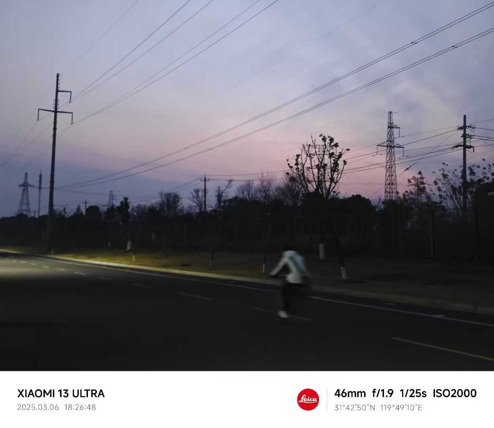

此时此刻我猛的醒来，环顾四周漆黑一片，大脑检索数据，开机中……深度思考（我现在是干什么为什么睡着，现在是晚上还是凌晨天没亮，假设现在是凌晨，那么我为什么会醒的这么早，那么还是再睡一会儿吧，可是为什么我没有印象，那好，我们再假设现在是晚上，好那让我们再回顾一下，拿起手机看一下时间六点十七，

哦不对，wc，（突然一下子所有的记忆如同潮水般涌入我的脑海中）现在是下午六点十七，要上晚自习了）叮当……宿主开机成功

我立马下床穿鞋，带上电脑走了，走到一半突然发现鼠标没带立马折返，现在是六点二十四分，而后走路步率开到最大化，走到一半突然发现晚上风景还可以，赶忙火急火燎的拍了一张，继续向前，现在是六点二十七，走到超市，突然想到每次都忘记买作业本，于是强迫症犯了去买本子，才踏进超市走到柜台，售货员突然说要支付的等一下他应该是去帮别人找商品了，于是头也不回继续前往晚自习了此时是六点二十九

